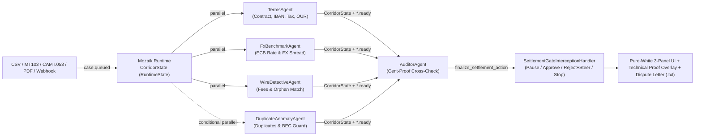

<p align="center">
  
</p>

<p align="center">
  <strong>Cross-Border Settlement, FX Spread &amp; Hidden-Fee Forensics powered by Concurrent Mozaik Agents</strong>
</p>

<p align="center">
  <a href="https://build.jigjoy.ai/">JigJoy Black Friday AI Hackathon</a> ·
  Built on <code>@mozaik-ai/core@6.0.0</code> ·
  Integer-Cents Math ·
  ECB Mid-Market Verification
</p>

---

> [!NOTE]
> **Production Architecture & Disclaimer:** CorridorAudit connects to live payout/accounting platforms, signed webhooks, inbound emails, bank SFTP/hot-folder feeds, and public European Central Bank reference rates (`api.frankfurter.app`). All credentials are encrypted with AES-256-GCM and every raw payload is preserved with a SHA-256 checksum in the Raw Data Vault (`raw_ingestions`). Output is for operational reconciliation and **is not financial or legal advice**.

---

## End-to-End Case Study & Architecture Blueprint

Read the complete judge-ready technical & product Case Study in **[`docs/Case Study/`](./docs/Case%20Study/README.md)**:

| Case Study Module | What It Covers |
| :--- | :--- |
| **[Case Study Home](./docs/Case%20Study/README.md)** | Executive summary, navigation tiles & full blueprint |
| **[01 · Problem Statement](./docs/Case%20Study/01-problem-statement.md)** | Why cross-border payouts leak 3%–7% across B2C & B2B |
| **[02 · Data Ingestion & Raw Vault](./docs/Case%20Study/02-data-ingestion-and-raw-vault.md)** | 5 live channels, 12 vendor platforms, AES-256 vault & `raw_ingestions` |
| **[03 · System Architecture & Pipeline](./docs/Case%20Study/03-system-architecture-and-pipeline.md)** | Full Input → Vault → Mozaik → Gate → Output blueprint & sequence diagram |
| **[04 · Mozaik 4+1 Agent System](./docs/Case%20Study/04-mozaik-4-plus-1-agents.md)** | 4+1 concurrent agents, `CorridorState` slots, `DynamicEndpointRouter` & breakpoints |
| **[05 · Financial Math & Algorithms](./docs/Case%20Study/05-algorithms-and-financial-math.md)** | Integer minor-unit math, Cent-Conservation Equation, FX bps & Mod-97 |
| **[06 · Outputs, Disputes & ROI](./docs/Case%20Study/06-outputs-disputes-and-roi.md)** | Worked `€5,000` EUR→USD example, dispute letters & B2C/B2B ROI |


---

## What It Does

Global SMBs, remote freelancers (`Upwork` / `Wise` / `Payoneer`), and fintech merchants (`Stripe` / checkout) lose **3% to 10%** on cross-border payouts to hidden FX spread markups, unexpected correspondent "lifting fees," ISO 20022 repair fees, duplicate wires, and stripped remittance references.

**CorridorAudit** ingests invoices and bank/platform payout files (`.csv`, `.txt` SWIFT MT103, `.xml` ISO 20022 `camt.053`, `.pdf`, `.json`, raw paste, webhooks, and `./data/inbox/` hot folder) and deploys **up to 5 concurrent Mozaik agents** (`@mozaik-ai/core@6.0.0`) backed by **20 deterministic TypeScript tools** to:

1. Isolate **hidden FX spread** against official European Central Bank (ECB) mid-market rates on the exact settlement value date.
2. Catch **wrongful fee deductions** (e.g., SWIFT `:71G:` receiver fees deducted when contract/wire specifies `:71A:OUR`).
3. Detect **ISO 13616 IBAN Mod-97 & SWIFT BIC checksum issues** that trigger repair fees, plus **unexplained short-pay variances**.
4. Match **orphaned wires** whose remittance reference (`:70:`) was stripped in transit using deterministic sender/date/amount scoring.
5. Flag **duplicate wires & beneficiary bank changes** (BEC risk) via conditional `DuplicateAnomalyAgent`.
6. Prove every cent (`ECB Mid-Market - FX Spread - Fees - Tax - Net Landed == Unexplained Variance`) with clickable `SourceRef[]` proofs and pause at an **interruptible Mozaik `InterceptionHandler` breakpoint** (`Approve`, `Reject & Steer`, `Stop`) before generating a downloadable bank dispute letter.

---

## Multi-Agent Concurrency Architecture (`@mozaik-ai/core@6.0.0`)



### How Agents Run Concurrently
- All agents join a single shared `CorridorState` (`defineRuntime<CorridorState>()`).
- When `case.queued` fires, `TermsAgent`, `FxBenchmarkAgent`, `WireDetectiveAgent` (and `DuplicateAnomalyAgent` when duplicate/BEC triggers hit) wake **simultaneously** in non-blocking `runLoop(...)` executions and write into isolated per-role state slots (`termsByCaseId`, `fxByCaseId`, `wireByCaseId`, `anomalyByCaseId`).
- Once all claimed parallel roles finish (`expectedRolesByCaseId`), **`AuditorAgent`** reactively triggers, verifies zero-drift integer-cents balance and `SourceRef[]` integrity, replays optimal corridor savings, and pauses via **`SettlementGateInterceptionHandler`** when an `OUR` fee breach, unexplained variance, or duplicate wire is detected.

---

## Quickstart (Runs in < 60 Seconds)

### Prerequisites
- **Node.js 20+**

### 1. Install & Configure Any LLM Provider
```bash
git clone https://github.com/sainibhaowal/Corridor-Audit.git
cd Corridor-Audit
npm install
cp .env.example .env
```

Add **any one** API key inside `.env` (or configure directly inside the Web UI via **System Settings** with live `/models` auto-discovery):

| Provider | `.env` Setting | Free Tier? |
|---|---|---|
| **NVIDIA NIM** | `LLM_PROVIDER=nvidia` + `NVIDIA_API_KEY=...` | Yes |
| **Google Gemini** | `LLM_PROVIDER=gemini` + `GEMINI_API_KEY=...` | Yes (AI Studio) |
| **Groq** | `LLM_PROVIDER=groq` + `GROQ_API_KEY=...` | Yes |
| **OpenRouter** | `LLM_PROVIDER=openrouter` + `OPENROUTER_API_KEY=...` | Yes (`:free`) |
| **OpenAI** | `OPENAI_API_KEY=...` *(auto-detected)* | Paid |
| **Anthropic** | `ANTHROPIC_API_KEY=...` *(auto-detected)* | Paid |
| **Ollama (Local)** | `LLM_PROVIDER=ollama` + `OLLAMA_MODEL=llama3.2` | Free Local |

### 2. Run
```bash
npm start          # Auto-builds if needed & boots Next.js Dashboard at http://127.0.0.1:3000
npm run dev        # Or launch Next.js hot-reload dev server directly
```
Or run headless terminal mode, production build & verification tests:
```bash
npm run build      # Builds optimized Next.js production bundle
npm run cli        # Runs all 6 synthetic Black Friday cases end-to-end in CLI
npm test           # Runs unit + Next.js App Router API end-to-end tests
npm run typecheck  # Runs TypeScript compiler check
```

---

## Data Sources & Verification
- **Bundled Synthetic Scenarios (`data/`):** 6 realistic multi-corridor cases (clean match, `:71A:OUR` fee violation + hidden 4.50% FX spread, invalid IBAN repair fee + unexplained `€120.00` short-pay, orphaned stripped-`:70:` wire, duplicate wire anomaly, and Upwork platform withdrawal with hidden 3.60% FX markup).
- **Public FX Benchmark:** Live [Frankfurter ECB API](https://api.frankfurter.app) (`0` API key required) with automatic fallback to `data/fallback-rates.json`.
- **Zero LLM Arithmetic:** All money calculations run strictly in integer minor units (`src/core/money.ts`).

---

## License
MIT — see [LICENSE](./LICENSE).
