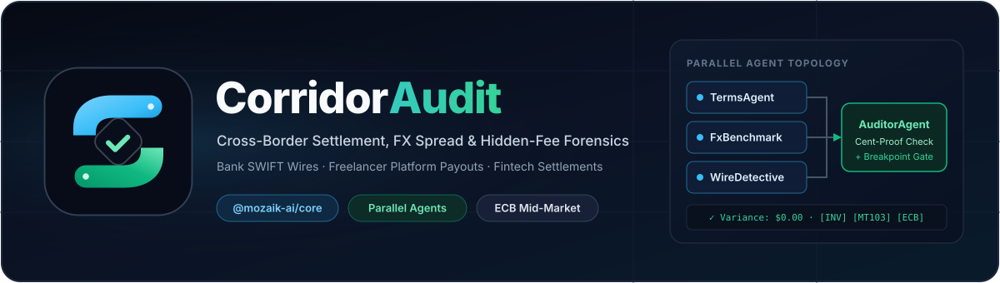
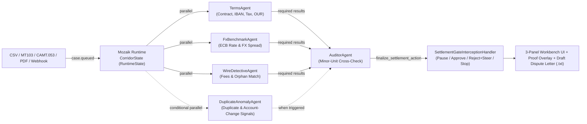

<p align="center">
  
</p>

<p align="center">
  <strong>Cross-Border Settlement, FX Spread &amp; Hidden-Fee Forensics powered by Concurrent Mozaik Agents</strong>
</p>

<p align="center">
  <a href="https://build.jigjoy.ai/">JigJoy Black Friday AI Hackathon</a> ·
  Built on <code>@mozaik-ai/core@6.0.0</code> ·
  Integer Minor-Unit Calculations ·
  ECB Reference-Rate Comparison
</p>

---

> [!NOTE]
> **Local Preview & Scope:** CorridorAudit is a local settlement-review workbench built with Next.js, SQLite (`node:sqlite`), and `@mozaik-ai/core`. It ingests supplied invoice, payout, and bank-record data, compares FX rates against public European Central Bank reference rates (`api.frankfurter.app`), and produces reviewable case verdicts and draft dispute letters. It does **not** transmit payments, authenticate source documents, or provide financial or legal advice. See [CHANGELOG.md](./CHANGELOG.md) and [Versioning Policy](./docs/VERSIONING.md).

---

## End-to-End Case Study & Architecture Blueprint

Read the complete technical & product Case Study in **[`docs/Case Study/`](./docs/Case%20Study/README.md)**:

| Case Study Module | What It Covers |
| :--- | :--- |
| **[Case Study Home](./docs/Case%20Study/README.md)** | Executive summary, navigation tiles & full blueprint |
| **[01 · Problem Statement](./docs/Case%20Study/01-problem-statement.md)** | How FX, fees, timing and incomplete records can affect cross-border payouts |
| **[02 · Data Ingestion & Raw Vault](./docs/Case%20Study/02-data-ingestion-and-raw-vault.md)** | 5 ingestion channels, integration adapters, SHA-256 digests & `raw_ingestions` |
| **[03 · System Architecture & Pipeline](./docs/Case%20Study/03-system-architecture-and-pipeline.md)** | Full Input → Vault → Mozaik → Gate → Output blueprint & sequence diagram |
| **[04 · Mozaik 4+1 Agent System](./docs/Case%20Study/04-mozaik-4-plus-1-agents.md)** | 3 concurrent specialists, conditional anomaly agent, follow-up auditor, `CorridorState` & breakpoints |
| **[05 · Financial Math & Algorithms](./docs/Case%20Study/05-algorithms-and-financial-math.md)** | Integer minor-unit math, Cent-Conservation Equation, FX bps & Mod-97 |
| **[06 · Outputs, Disputes & ROI](./docs/Case%20Study/06-outputs-disputes-and-roi.md)** | Worked `€5,000` EUR→USD example, dispute letters & B2C/B2B ROI |
| **[07 · Security, Hashing & Data Protection](./docs/Case%20Study/07-security-hashing-and-data-protection.md)** | Security boundaries, configurable webhook HMAC checks, SHA-256 fingerprints & data-protection controls |
| **[Implementation Architecture](./docs/ARCHITECTURE.md)** | Module-by-module codebase & runtime implementation notes |
| **[Developer Engineering Docs](./docs/developer/README.md)** | Full API reference (29 routes), 17-table SQLite schema, codebase module map & `.env`/security config |
| **[2-Minute Demo Guide](./docs/DEMO-GUIDE.md)** | Step-by-step walkthrough: sidebar drag-and-drop upload, live Mozaik stream, breakpoint & `.pdf`/`.csv`/`.txt`/`.json` preview |


---

## What It Does

Global SMBs, remote freelancers (`Upwork` / `Wise` / `Payoneer`), and fintech merchants (`Stripe` / checkout) can incur cross-border payout costs from FX spreads, correspondent fees, repair fees, duplicate wires, and stripped remittance references. The amounts and causes vary by provider, corridor, contract, and source records; this application does not establish market-wide loss rates.

**CorridorAudit** ingests supplied invoices and bank/platform payout files (`.csv`, `.txt` SWIFT MT103, `.xml` ISO 20022 `camt.053`, `.pdf`, `.json`, raw paste, webhooks, and `./data/inbox/` hot folder) and runs **three concurrent Mozaik specialist agents**, a conditional fourth anomaly agent, and a follow-up auditor (`@mozaik-ai/core@6.0.0`) with deterministic TypeScript calculations to:

1. Estimate **FX spread** against the European Central Bank (ECB) reference rate for the settlement value date when available, with bundled fallback rates where available.
2. Catch **unexpected fee deductions** (e.g., SWIFT `:71G:` receiver fees deducted when contract/wire specifies `:71A:OUR`).
3. Check **ISO 13616 IBAN Mod-97 checksums** and **SWIFT BIC format**, which may help identify malformed identifiers, plus **unexplained short-pay variances**. These checks do not validate account ownership or establish that a repair fee was caused by an identifier.
4. Match **orphaned wires** whose remittance reference (`:70:`) was stripped in transit using deterministic sender/date/amount scoring.
5. Flag possible **duplicate wires and supplied beneficiary account changes** with conditional `DuplicateAnomalyAgent` heuristic checks. These flags are not a fraud determination.
6. Calculate a **minor-unit reconciliation residual** (`ECB reference equivalent - estimated FX spread - normalized fees - normalized tax - net settled == unexplained variance`), attach structured `SourceRef[]` references, and pause selected risk-bearing finalization actions at an **interruptible Mozaik `InterceptionHandler` breakpoint** (`Approve`, `Reject & Steer`, `Stop`). A downloadable dispute-letter draft is produced only for applicable fee findings; it is not sent automatically.

---

## Multi-Agent Concurrency Architecture (`@mozaik-ai/core@6.0.0`)



### How Agents Run Concurrently
- All agents join a single shared `CorridorState` (`defineRuntime<CorridorState>()`).
- When `case.queued` fires, `TermsAgent`, `FxBenchmarkAgent`, `WireDetectiveAgent` (and `DuplicateAnomalyAgent` when duplicate/BEC triggers hit) wake **simultaneously** in non-blocking `runLoop(...)` executions and write into isolated per-role state slots (`termsByCaseId`, `fxByCaseId`, `wireByCaseId`, `anomalyByCaseId`).
- Once all expected specialist roles finish (`expectedRolesByCaseId`), **`AuditorAgent`** triggers, checks the minor-unit reconciliation and `SourceRef[]` structure, computes a comparison scenario, and may pause finalization via **`SettlementGateInterceptionHandler`** for an `OUR` fee discrepancy, unexplained variance, duplicate wire, or supplied account-change signal. Citation structure checks do not authenticate the underlying records.

---

## Quickstart (Runs in < 60 Seconds)

### Prerequisites
- **Node.js 22.5 or later** (uses built-in `node:sqlite`)
- **npm**

### 1. Install & Configure Any LLM Provider
```bash
git clone https://github.com/sainibhaowal/Corridor-Audit.git
cd Corridor-Audit
npm install
cp .env.example .env
```

For PowerShell, copy the environment template with `Copy-Item .env.example .env`. Configure one supported model provider in `.env` (or use **System Settings** for provider configuration and server-side model discovery). Ollama uses a locally available endpoint and does not require a hosted API key:

| Provider | `.env` Setting | Free Tier? |
|---|---|---|
| **NVIDIA NIM** | `LLM_PROVIDER=nvidia` + `NVIDIA_API_KEY=...` | Yes |
| **Google Gemini** | `LLM_PROVIDER=gemini` + `GEMINI_API_KEY=...` | Yes (AI Studio) |
| **Groq** | `LLM_PROVIDER=groq` + `GROQ_API_KEY=...` | Yes |
| **OpenRouter** | `LLM_PROVIDER=openrouter` + `OPENROUTER_API_KEY=...` | Yes (`:free`) |
| **OpenAI** | `OPENAI_API_KEY=...` *(auto-detected)* | Paid |
| **Anthropic** | `ANTHROPIC_API_KEY=...` *(auto-detected)* | Paid |
| **Ollama (Local)** | `LLM_PROVIDER=ollama` + `OLLAMA_MODEL=llama3.2` | Free Local |

### 2. Run
```bash
npm run dev        # Launch Next.js dev server at http://127.0.0.1:3000
npm start -- --no-open   # Serve built app on http://127.0.0.1:3000
```
Or run build, CLI, and verification checks:
```bash
npm run typecheck  # Runs TypeScript compiler check
npm test           # Runs unit + API tests
npm run build      # Builds Next.js production bundle
npm run cli -- <input-file>   # Runs CLI audit against a supplied input file
```

---

## Data Sources & Verification
- **Public FX Benchmark:** Live [Frankfurter ECB API](https://api.frankfurter.app) (`0` API key required) with automatic fallback to `data/fallback-rates.json`.
- **Integer Minor-Unit Arithmetic:** Money calculations run in integer minor units (`src/core/money.ts`); FX conversion uses JavaScript `number` arithmetic with `Math.round`.
- **Important Boundaries:** The app does not authenticate source documents, verify account ownership, transmit funds, or provide financial/legal advice.

---

## License
MIT. See [LICENSE](./LICENSE).
