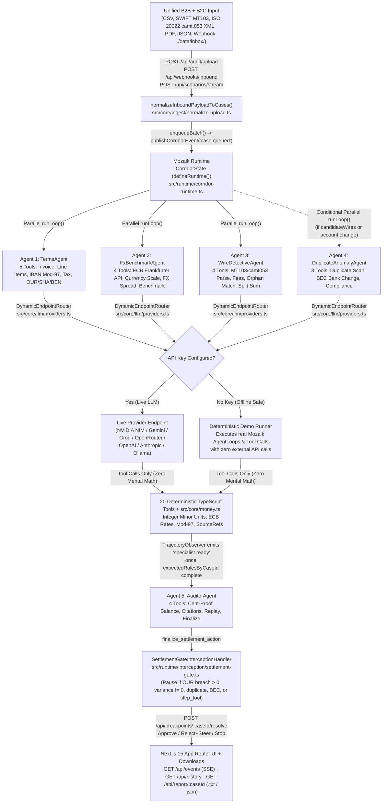
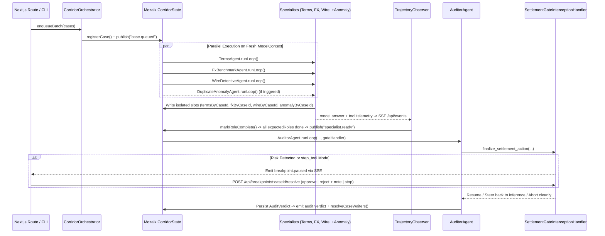

# CorridorAudit — Actual Implementation Architecture

> **Stack:** Next.js 15 App Router · React 19 · TypeScript · Tailwind CSS + shadcn/ui · `@mozaik-ai/core@6.0.0`  
> **Scope:** Unified B2B & B2C Cross-Border Settlement, FX Spread & Hidden-Fee Forensics (Synthetic & Public ECB Reference Data Only)

---

## 1. End-to-End Hybrid System Architecture (Actual Codebase)

All 5 agents are **independent top-level Mozaik `Agent` peers** (created via `createAgent(...)` and registered via `join(...)` — **not** nested subagents). They communicate through shared `CorridorState` (`RuntimeState`) and `SemanticEvent`s, while **100% of financial math** executes inside 20 deterministic TypeScript tools.

---

## 2. How the 5 Peer Mozaik Agents Run Concurrently

Defined in [src/runtime/agents/corridor-agents.ts](file:///c:/Users/Ravin/Projects/Projetcs%20Alpha/JigJoy/src/runtime/agents/corridor-agents.ts) and coordinated by [src/runtime/agents/trajectory-observer.ts](file:///c:/Users/Ravin/Projects/Projetcs%20Alpha/JigJoy/src/runtime/agents/trajectory-observer.ts) and [src/runtime/orchestrator.ts](file:///c:/Users/Ravin/Projects/Projetcs%20Alpha/JigJoy/src/runtime/orchestrator.ts):

### Key Concurrency & Safety Guarantees
- **Isolated Per-Role State Slots:** Specialists never overwrite each other's outputs (`termsByCaseId`, `fxByCaseId`, `wireByCaseId`, `anomalyByCaseId` in [corridor-runtime.ts](file:///c:/Users/Ravin/Projects/Projetcs%20Alpha/JigJoy/src/runtime/corridor-runtime.ts)).
- **Fresh `ModelContext` per Case:** Prevents cross-case context bleed across queued batches.
- **Global Singleton (`globalThis.__corridorOrchestrator`):** Shares one live Mozaik runtime, SSE subscriber set, `pendingApprovals`, and hot-folder watcher (`./data/inbox/`) across all Next.js App Router API routes.
- **Rate-Limit Resilience:** `DynamicEndpointRouter` enforces `MAX_CONCURRENT_LLM_CALLS` via `AsyncSemaphore` with exponential backoff retries on `429`/`500`/`502`/`503`/`504`.

---

## 3. Exact Integer-Cents Math & Conservation Equation

Implemented once in [src/core/money.ts](file:///c:/Users/Ravin/Projects/Projetcs%20Alpha/JigJoy/src/core/money.ts) and shared across `audit-tools.ts` (`computeCaseAuditNumbers`) and `settlement-gate.ts`:

$$\text{ECB Mid-Market}_{\text{settled}} - \text{FX Spread Loss} - \text{Deducted Fees} - \text{Withholding Tax}_{\text{settled}} - \text{Net Landed} = \text{Unexplained Variance}$$

- **Decimal Exponents Handled Safely:** `0`-decimal (`JPY`, `KRW`, `VND`), `2`-decimal (`USD`, `EUR`, `GBP`, etc.), and `3`-decimal (`BHD`, `KWD`, `OMR`, `JOD`, `TND`) via `MINOR_UNIT_EXPONENTS` and `convertMinorUnits()`.
- **Disclosed Rate Isolation:** When `:36:` / `bankAppliedRate` is present, FX spread is computed directly from the applied rate so any separate unexplained short-pay stays visible in `unexplainedVarianceMinor`.
- **Cross-Currency Tax Normalization:** Statutory withholding tax is converted from invoice currency into `settledCurrency` at the ECB mid-market rate before conservation verification.
- **Public ECB Reference Rates:** Fetched live from `https://api.frankfurter.app` with 5s timeout and automatic fallback to [data/fallback-rates.json](file:///c:/Users/Ravin/Projects/Projetcs%20Alpha/JigJoy/data/fallback-rates.json).

---

## 4. Directory & Module Map (Verified On Disk)

| Layer | Paths | Responsibility |
|---|---|---|
| **Core Math & FX** | `src/core/types.ts`, `src/core/money.ts`, `src/core/fx/frankfurter-client.ts` | Domain types, integer minor-unit math, IBAN Mod-97 / BIC validation, Frankfurter ECB client |
| **Multi-Format Ingestion** | `src/core/parsers/{mt103,csv,camt053,pdf}-parser.ts`, `src/core/ingest/normalize-upload.ts` | Parses SWIFT MT103, ISO 20022 `camt.053`, CSV, FlateDecode PDF, and JSON webhooks |
| **LLM Router** | `src/core/llm/providers.ts` | `DynamicEndpointRouter` for 7 live providers (`nvidia`, `gemini`, `groq`, `openrouter`, `openai`, `anthropic`, `ollama`) + offline `demo` runner |
| **Mozaik Runtime & Gate** | `src/runtime/corridor-runtime.ts`, `src/runtime/orchestrator.ts`, `src/runtime/interception/settlement-gate.ts` | `CorridorState`, global orchestrator singleton, `./data/inbox` watcher, `SettlementGateInterceptionHandler` (`risk_only` / `step_tool`) |
| **5 Agents & 20 Tools** | `src/runtime/agents/{agent-prompts,corridor-agents,trajectory-observer}.ts`, `src/runtime/tools/*.ts` | 5 peer Mozaik agents + 20 Zod-validated deterministic tools wrapped with SSE telemetry (`instrument.ts`) |
| **Next.js App Router API** | `src/app/api/{health,events,history,settings/*,scenarios/*,webhooks/inbound,audit/upload,breakpoints/[caseId]/resolve,report/[caseId]}/route.ts` | Node.js runtime REST + SSE streaming endpoints |
| **Next.js + Tailwind UI** | `src/app/{layout,page,globals}.tsx`, `src/components/*.tsx`, `src/components/ui/*.tsx` | React 19 + Tailwind + shadcn-style 3-panel dashboard, modals, and keyboard shortcuts (`Ctrl+Enter` / `Esc`) |
| **Headless CLI & Boot** | `src/cli.ts`, `scripts/start.mjs` | Headless CLI (`npm run cli`) and auto-build production launcher (`npm start`) |
| **Verification Suite** | `tests/{money,mt103-parser,reconciliation-math,server-e2e}.test.ts` | Unit + Next.js App Router API E2E tests (`Approve` + `Reject & Steer`) |
