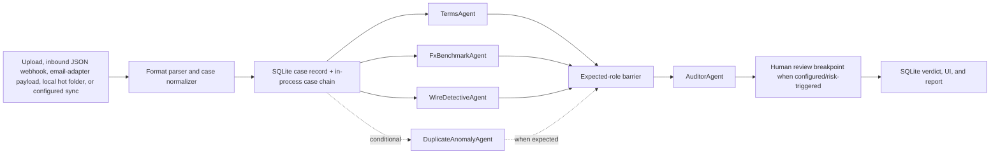

# CorridorAudit implementation architecture

This document describes the code currently in this repository. CorridorAudit is a local preview application for settlement review. Its integration catalog and UI are broader than its provider-specific connectors; see the limitations below before treating an input path as operational.

## Runtime flow



Three expected specialists run concurrently for a case; anomaly analysis is conditional on candidate wires or account-change evidence. `AuditorAgent` runs after the expected specialists complete. `enqueueBatch` returns promises for the cases, while the orchestrator serializes case execution through `batchChain`. Shared Mozaik state, active queue, agent activity and pending approvals are process-local. Cases, verdicts and raw-ingestion records are stored in SQLite and loaded when the runtime initializes.

## Inputs and persistence

Implemented ingestion paths include:

- `POST /api/audit/upload`: file or text upload. It stores the raw input before normalization and records parse outcome for the request.
- `POST /api/webhooks/inbound`: JSON payload normalized to cases. Stripe, Wise, and Corridor HMAC signatures can be checked when the corresponding secrets are configured and signature enforcement is enabled. Enforcement is disabled by default.
- `POST /api/webhooks/email`: a JSON email-adapter payload with supported attachments or inline text. It does not create an email mailbox or configure a mail provider.
- Local `data/inbox` watcher: watches supported files in a directory. It is a hot-folder adapter, not an SFTP transport.
- Integration sync route and in-process timer: connects catalog settings to connector polling. Stripe, Wise, QuickBooks Online, and Xero have provider-specific request/mapping code. Other catalog entries use a generic JSON endpoint or local-folder adapter, or are setup placeholders. Provider coverage, auth scope, pagination, field mappings, and refresh behavior are not production-complete.

The `raw_ingestions` table stores the original content (encrypted at rest via AES-256-GCM alongside `cases`, `audit_verdicts`, and `review_approvals`) and a SHA-256 digest with metadata and parse status. The digest can detect content changes when compared with the stored value, though SQLite rows are not immutable WORM storage. Integration credentials and webhook secrets also use AES-256-GCM; the vault key is loaded from `CORRIDOR_VAULT_KEY` (required as 64 hex chars in production) or a local key file in dev.

The default workspace is `ws-default`. Role-based access control (`viewer < analyst < controller < owner`) and Cognito/session authentication (`CORRIDOR_AUTH_MODE=cognito` vs. `local` loopback evaluation) are implemented in `src/core/security/auth.ts`, `authorization.ts`, and `src/middleware.ts`; see [`docs/developer/env-and-security.md`](./developer/env-and-security.md) and [`docs/production/01-current-state.md`](./production/01-current-state.md) for deployment limits.

## Agents and tools

Five peer Mozaik agents are created in [`src/runtime/agents/corridor-agents.ts`](../src/runtime/agents/corridor-agents.ts):

| Agent | Current responsibility | Tools |
| --- | --- | --- |
| `TermsAgent` | Invoice terms, line-item arithmetic, IBAN checksum/BIC format, supplied withholding, fee clause | 5 |
| `FxBenchmarkAgent` | Rate lookup, currency normalization, FX spread, corridor fee benchmark | 4 |
| `WireDetectiveAgent` | Wire parsing, fee analysis, orphan matching, split-payment reconciliation | 4 |
| `DuplicateAnomalyAgent` | Duplicate-wire and supplied account-change checks, heuristic flags | 3 |
| `AuditorAgent` | Reconciliation, SourceRef structure checks, corridor replay, verdict finalization | 4 |

The first four agents write to role-specific maps in [`src/runtime/corridor-runtime.ts`](../src/runtime/corridor-runtime.ts). The auditor is activated after the expected-role barrier. The tool inventory totals twenty. Tool execution is mediated by the configured model provider; the audit tools perform the listed calculations deterministically, but the application does not authenticate source documents or eliminate judgment risk.

## Arithmetic and evidence

Amounts are represented as integer minor-unit values. The code explicitly overrides selected zero- and three-decimal currencies; other codes default to two decimals. Conversions use JavaScript numeric FX rates and `Math.round`, so calculations are not arbitrary-precision decimal arithmetic.

For a case, the auditor computes the residual:

```text
mid-market expected amount
- estimated FX spread loss
- normalized fees
- normalized withholding tax
- net settled amount
= unexplained variance
```

Frankfurter is queried for ECB reference rates, with bundled fallback values when available. `SourceRef` validation checks required fields and excerpts; it does not verify that a cited file or bank record is authentic or that a figure matches it.

## Model providers

[`src/core/llm/providers.ts`](../src/core/llm/providers.ts) routes agent inference to NVIDIA NIM, Gemini, Groq, OpenRouter, OpenAI, Anthropic, or Ollama. The Settings view can request model lists through server-side provider discovery. A working key/endpoint is required for agent execution; no offline demo runner or bundled scenario executor is included in the current code.

## API surface

Implemented App Router endpoints (29 route files) include `/api/health`, `/api/events` (SSE), `/api/history`, `/api/audit/upload`, `/api/webhooks/inbound`, `/api/webhooks/email`, `/api/ingestions/*`, `/api/integrations/*`, `/api/settings/*`, `/api/breakpoints/[caseId]/resolve`, `/api/report` & `/api/report/[caseId]` (`.pdf`, `.csv`, `.txt`, `.json` + `?preview=1`), `/api/queue/dead-letters*`, `/api/audit-log`, `/api/auth/*`, `/api/runtime/status`, and `/api/terminal`. See the full endpoint contract in [`docs/developer/api-reference.md`](./developer/api-reference.md).

The terminal is an application command console with an allowlist; it does not execute arbitrary operating-system shell commands.

## Local development

Node.js 22.5 or later is required for the built-in `node:sqlite` module. `npm run dev` starts the development server; `npm run build` and `npm start` run the production bundle. Both bind to `127.0.0.1:3000` by default. See the [root README](../README.md) and [Developer Engineering Docs](./developer/README.md) for full setup and module details.
