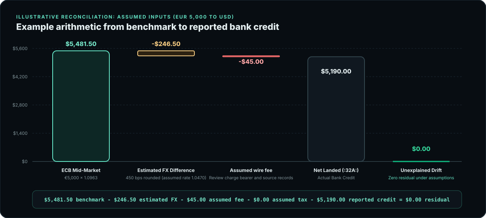
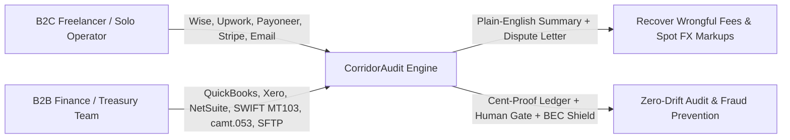

# 01 · Problem Statement — The Silent Cross-Border Settlement Leak

## 1. The Core Problem

Every day, millions of cross-border invoices and payouts move across **SWIFT MT103**, **ISO 20022 (`camt.053`)**, and global payout platforms (**Wise, Stripe, Payoneer, Upwork, Revolut**). Between the moment a client or employer sends money and the moment it lands in the recipient's bank account, **3% to 7% of the settlement value silently disappears**.

Existing accounting tools (**QuickBooks, Xero, Excel**) only see the **net amount that finally landed** — they do not reconstruct the hidden FX spread against the official **European Central Bank (ECB)** rate on the exact settlement `valueDate`, nor do they enforce SWIFT `:71A:OUR` fee-bearer clauses automatically.

---

## 2. The Four Silent Settlement Leaks

| Leak Type | What Happens in Practice | Who Suffers Most | Recoverable? |
| :--- | :--- | :--- | :--- |
| **1. Hidden FX Spread** | Bank advertises `$0` wire fee while applying a rate `300–500 bps` (`3%–5%`) worse than ECB mid-market (`:36:`). | B2C Freelancers & B2B Importers/Exporters | Measurable for rail switching & rebating |
| **2. `:71A:OUR` Fee Violation** | Contract & MT103 specify `OUR` (sender pays all fees), yet an intermediary bank deducts `$25–$65` (`:71G:`). | B2B Vendors & B2C Contractors | **Yes — 100% claimable via bank/client dispute** |
| **3. Silent Short-Pays & Orphan Wires** | Remittance tag `:70:` is stripped or truncated; split installments or repair fees (`IBAN_MOD97_ERR`) go unmatched. | B2B AR/AP Controllers | **Yes — automated matching & recovery** |
| **4. Duplicate Payouts & BEC Fraud** | Retry webhooks send duplicate wires, or a compromised email swaps a vendor's IBAN right before payout. | B2B Treasury & Ops Teams | **Critical — prevented before close** |

---

## 3. Worked Financial Impact (Real `$5,481.50` Settlement Example)

In a standard **`€5,000.00` EUR → USD** wire settled on `2026-11-24`:
- **Official ECB Mid-Market Rate (`1.0963`):** Should be **`$5,481.50`**.
- **Bank Applied Rate (`1.0470`) + Lifting Fee (`$45.00`):** Recipient receives **`$5,190.00`**.
- **Total Corridor Leakage:** **`$291.50` (`5.32%`)** lost on a single wire — `$246.50` in hidden FX markup + `$45.00` in an illegal `:71G:` fee deduction under `:71A:OUR`.

---

## 4. One Platform for Both B2C & B2B

| Capability | B2C Freelancer / Contractor Mode | B2B Finance / Treasury Mode |
| :--- | :--- | :--- |
| **Primary Data Sources** | Wise, Payoneer, Upwork, Stripe, Forwarding Email | QuickBooks, Xero, NetSuite, Mercury/Brex, Open Banking, Bank SFTP (`MT103`/`camt.053`) |
| **Primary Pain Solved** | "Why did `$291` vanish from my `€5,000` client payment?" | Automated multi-currency reconciliation, `:71A:OUR` recovery, duplicate & BEC detection |
| **Governance** | Instant plain-English breakdown + 1-click dispute letter | Role-based Team Members, HMAC-signed webhooks, `SettlementGateInterceptionHandler` approval |
