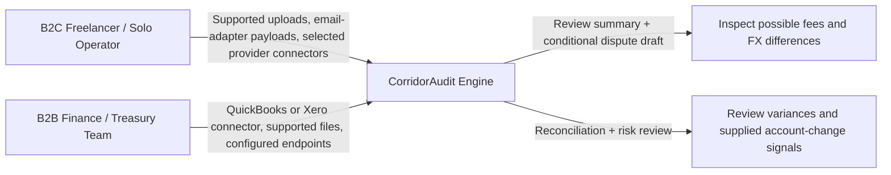

# 01 · Problem Statement — The Silent Cross-Border Settlement Leak

## 1. The Core Problem

Cross-border payments can lose value through FX conversion, fees, timing differences, or incomplete remittance data. CorridorAudit explores how these differences can be identified by comparing supplied invoice, payout, and bank records. The current app is a local evaluation prototype, not a live network covering millions of payments.

Accounting and payout systems may hold different parts of a transaction. With matching source records and a usable settlement date, CorridorAudit can compare a supplied applied rate with a public ECB reference rate and surface fee-bearer inconsistencies for review. It does not enforce bank instructions or independently validate contracts.

---

## 2. Four Settlement Review Signals

| Leak Type | What Happens in Practice | Who Suffers Most | Recoverable? |
| :--- | :--- | :--- | :--- |
| **1. FX Rate Difference** | The applied exchange rate can differ from a public reference rate; the size and cause depend on the transaction records. | Cross-border payees | Measurable when amount, currencies, date and applied rate are available |
| **2. `:71A:OUR` Fee-Bearer Mismatch** | A supplied OUR instruction can be compared with reported deductions. | Cross-border payees | **Review indicator; liability depends on evidence and contract** |
| **3. Short-Pays & Orphan Wires** | Remittance references may be missing or incomplete; candidate matching can surface records for review. | Finance teams | **Candidate matching only; recovery is a human/provider process** |
| **4. Duplicate Payouts & Account Changes** | Supplied records may contain duplicate candidates or changed account references. | Finance and operations teams | **Can flag signals; does not prevent a payment** |

---

## 3. Worked Financial Example (Illustrative Inputs)

For an illustrative EUR 5,000.00 to USD case using a reference rate of 1.0963, an applied rate of 1.0470, an assumed USD 45.00 fee, and a reported USD 5,190.00 credit:
- **Official ECB Mid-Market Rate (`1.0963`):** Should be **`$5,481.50`**.
- **Bank Applied Rate (`1.0470`) + Lifting Fee (`$45.00`):** Recipient receives **`$5,190.00`**.
- **Arithmetic difference from the ECB benchmark:** **USD 291.50** (about 5.32% of the benchmark), comprising an estimated USD 246.50 rate difference and the assumed USD 45.00 fee. These inputs illustrate the calculation. They do not establish that a fee was illegal, recoverable, or actually charged.

---

## 4. One Platform for Both B2C & B2B

| Capability | B2C Freelancer / Contractor Mode | B2B Finance / Treasury Mode |
| :--- | :--- | :--- |
| **Example Sources** | File uploads, supported email-adapter payloads, selected provider connectors | QuickBooks and Xero connectors, supported files, configured endpoints |
| **Example Question** | What explains the difference between the instructed amount and bank credit? | How do supplied invoice and settlement records reconcile, and what needs review? |
| **Governance** | Review summary and conditional draft | Configurable webhook signature checks and risk breakpoint; no user roles or team authorization |
