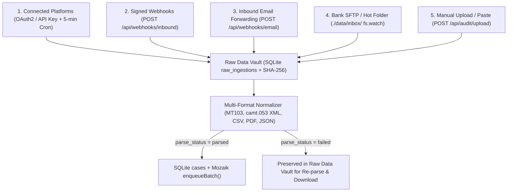

# 02 · Data Ingestion, Vendor Platforms & Raw Data Vault

## 1. Where the Data Comes From (5 Live Channels)

CorridorAudit is built for real-world operations where invoices, bank statements, and payout events arrive from **5 distinct channels** — all converging into the **Raw Data Vault (`raw_ingestions`)** before parsing:

---

## 2. Supported Vendor Platforms (12 Production Connectors)

All 12 platforms are configured in **[Data Sources](../../src/components/integrations-panel.tsx)** (`GET /api/integrations`) and backed by **AES-256-GCM encrypted credentials** in SQLite:

| Platform | Audience | Auth Modes | What Data Is Ingested | Connector / Channel |
| :--- | :--- | :--- | :--- | :--- |
| **Stripe** | B2C & B2B | OAuth2 / Restricted Key | Payouts, balance transactions, processing & FX fees | `fetchStripeCases` + `Stripe-Signature` webhook |
| **Wise (Personal & Business)** | B2C & B2B | OAuth2 / API Token | Multi-currency transfers, applied FX rate, transfer fees | `fetchWiseCases` + `X-Signature-SHA256` webhook |
| **Payoneer** | B2C & B2B | API Token / OAuth2 | Global marketplace payouts & withdrawal fees | `fetchGenericEndpointCases` |
| **Upwork** | B2C | OAuth2 / Email Forward | Escrow releases, 10% platform service fees, net landed | CSV / OAuth / Email attachment |
| **Revolut Business** | B2C & B2B | API Key / OAuth2 | Multi-currency account transactions & FX legs | `fetchGenericEndpointCases` |
| **Mercury / Brex Treasury** | B2B | Treasury API Token | ACH & international SWIFT wire deductions | `fetchGenericEndpointCases` |
| **QuickBooks Online** | B2B | OAuth2 / Access Token | Company invoices, contracted currencies, customer refs | `fetchQuickBooksCases` |
| **Xero** | B2B | OAuth2 / Access Token | Invoices, credit notes, WHT lines, expected currency | `fetchXeroCases` |
| **Oracle NetSuite** | B2B | SuiteTalk / TBA Token | Subsidiary invoices, intercompany wires, ERP postings | `fetchGenericEndpointCases` |
| **Open Banking (Plaid / TrueLayer)** | B2C & B2B | OAuth2 Link / Token | Live bank statement feeds (HSBC, Citi, Deutsche Bank, JPMorgan) | `fetchGenericEndpointCases` |
| **Bank SFTP / ISO 20022 Hot Folder** | B2B | Hot Folder (`./data/inbox/`) | Automated `MT103` & `camt.053` XML statement drops | `startHotFolderWatcher` + `fetchHotFolderCases` |
| **Inbound Email Forwarding** | B2C & B2B | Unique Address (`inbox+ws-default@...`) | Client PDF invoices, Upwork receipts, SWIFT advices | `parseInboundEmailToCases` |

---

## 3. Security: AES-256-GCM Vault & HMAC Webhook Verification

1. **Credential Vault ([`src/core/security/vault.ts`](../../src/core/security/vault.ts)):**
   - Every OAuth `access_token`, `refresh_token`, API key, and webhook signing secret is encrypted using **AES-256-GCM** (`v1:<iv_b64>:<tag_b64>:<ciphertext_b64>`).
   - Key is loaded from `CORRIDOR_VAULT_KEY` or persisted locally at `data/.vault-key` (`0600`).
2. **Webhook Signature Verification ([`src/core/security/webhook-signatures.ts`](../../src/core/security/webhook-signatures.ts)):**
   - Constant-time `crypto.timingSafeEqual` verification for Stripe (`Stripe-Signature`), Wise (`X-Signature-SHA256`), and CorridorAudit (`X-Corridor-Signature`).

---

## 4. The Raw Data Vault (`raw_ingestions`)

Every incoming payload is stored **before parsing** in SQLite (`raw_ingestions`) so zero raw evidence is ever lost — even if a parser encounters a malformed bank file. Users and auditors can inspect every stored payload in the **Raw Data Vault** view (`GET /api/ingestions`, `GET /api/ingestions/[id]?download=1`, and `POST /api/ingestions/[id]/reprocess`).
