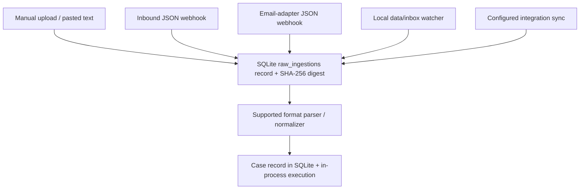

# 02 · Data ingestion and raw-ingestion records

## Implemented input paths

The application has five input paths, with different implementation depth:

- **Manual upload:** `POST /api/audit/upload` supports the formats implemented by the parsers: CSV, SWIFT MT103 text, camt.053 XML, PDF text extraction, JSON, and pasted text. The PDF parser extracts text; it is not general OCR.
- **Inbound webhook:** `POST /api/webhooks/inbound` accepts normalized JSON and supported input payloads. Signature checks exist for Stripe, Wise, and Corridor headers; signature enforcement is configurable and off by default.
- **Email adapter:** `POST /api/webhooks/email` accepts a JSON payload with supported attachments or inline text. The app does not host an email address or integrate directly with Postmark, Resend, or Mailgun delivery.
- **Local hot folder:** the runtime watches `data/inbox` (or `HOT_FOLDER`) for supported files. There is no SFTP client or bank transport integration.
- **Integration sync:** a manual sync route and an in-process timer call the configured connector implementation. The timer is not a durable scheduler.

## Integration catalog versus connectors

The UI catalog contains twelve entries. Catalog presence does not mean that a complete, provider-certified connector exists.

| Connector implementation | Current behavior |
| --- | --- |
| Stripe | Calls the payouts endpoint and maps returned payout fields into cases. |
| Wise | Reads profiles/transfers and maps returned transfer fields into cases. |
| QuickBooks Online | Reads a limited page of invoice records and maps them into cases. |
| Xero | Reads a limited invoice page and maps records into cases. |
| Other catalog API providers | Use a generic configured HTTP JSON endpoint; each provider needs a compatible endpoint and normalized response. This is not a provider-specific implementation. |
| Bank hot folder | Reads supported local files; does not connect to SFTP. |
| Inbound email | Parses the app's JSON adapter format; does not provide mail hosting. |

OAuth authorization and callback code is available for a limited set of providers. Provider API credentials, scopes, callback URLs, token renewal, pagination, error handling, and data mapping require provider-specific configuration and further integration work before operational use. The current app does not include general-purpose credential rotation or a production connector certification suite.

## Credential storage and webhook checks

Integration credentials and webhook signing secrets are encrypted with AES-256-GCM by [`src/core/security/vault.ts`](../../src/core/security/vault.ts). The key comes from `CORRIDOR_VAULT_KEY` or is created in `data/.vault-key`. Protect both database and key; the database alone is not sufficient to restore encrypted credentials.

The webhook implementation uses constant-time HMAC comparisons for the supported signature schemes. `requireWebhookSignature` defaults to false, so operators must explicitly enable it and configure the relevant secret before accepting external traffic.

## Raw-ingestion record behavior

`raw_ingestions` records the submitted content, SHA-256 digest, size, metadata, parse state, and linked case IDs. The digest is an integrity reference, not an immutable storage guarantee. Raw content is stored in SQLite without encryption. Access control, retention policy, tamper-evident external storage, and authenticated audit access are not implemented.

The UI/API can list and retrieve raw-ingestion records, download content, and request reprocessing. Parse retention behavior depends on the route used; the raw table should not be treated as a complete evidence-management system.
