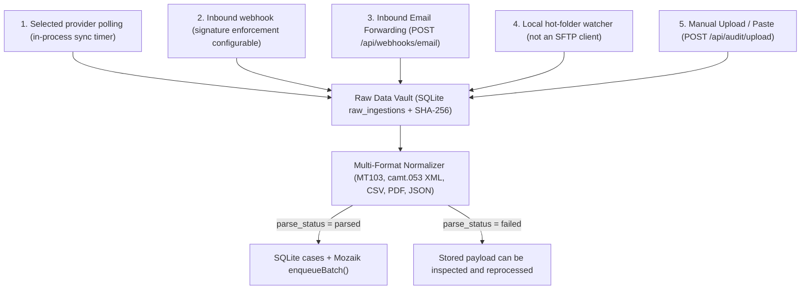

# 02 · Data Ingestion, Vendor Platforms & Raw Data Vault

## 1. Where the Data Comes From (Five Implemented Ingestion Paths)

The application accepts data through five paths. Available provider catalog entries do not all have provider-specific connectors. Incoming payloads are recorded in `raw_ingestions` before route parsing; the local hot-folder watcher also records a file before parsing.

---

## 2. Provider Catalog and Connector Coverage

The catalog contains 12 provider entries in **[Data Sources](../../src/components/integrations-panel.tsx)**. Four have provider-specific polling code: Stripe, Wise, QuickBooks Online, and Xero. Other entries may use a generic configured JSON endpoint, the local hot-folder adapter, an inbound payload adapter, or remain setup placeholders. Credential encryption applies to stored integration secrets.

| Platform | Audience | Catalog Auth Options | What Data Is Ingested | Connector / Channel |
| :--- | :--- | :--- | :--- | :--- |
| **Stripe** | B2C & B2B | OAuth2 / Restricted Key | Payout records from the configured API request (currently limited fields) | `fetchStripeCases`; webhook signature check available, payload must match supported JSON shape |
| **Wise (Personal & Business)** | B2C & B2B | OAuth2 / API Token | Transfer records and provider-reported source and target values/rate | `fetchWiseCases`; webhook signature check available, payload must match supported JSON shape |
| **Payoneer** | B2C & B2B | API Token / OAuth2 | Provider-specific records only if configured | Generic endpoint adapter; no provider-specific connector |
| **Upwork** | B2C | OAuth2 / Email Forward | No provider-specific connector | Supported CSV or email-adapter payload |
| **Revolut Business** | B2C & B2B | API Key / OAuth2 | Provider-specific records only if configured | Generic JSON endpoint adapter |
| **Mercury / Brex Treasury** | B2B | Treasury API Token | Provider-specific records only if configured | Generic JSON endpoint adapter |
| **QuickBooks Online** | B2B | OAuth2 / Access Token | Invoice records; adapter creates a placeholder wire at the invoice amount | `fetchQuickBooksCases` |
| **Xero** | B2B | OAuth2 / Access Token | Invoice records; the adapter currently creates a matching placeholder wire | `fetchXeroCases` |
| **Oracle NetSuite** | B2B | SuiteTalk / TBA Token | Provider-specific records only if configured | Generic JSON endpoint adapter |
| **Open Banking (Plaid / TrueLayer)** | B2C & B2B | OAuth2 Link / Token | Catalog entry; provider mappings vary | Generic JSON endpoint unless a provider-specific mapping is added |
| **Local Bank File Hot Folder** | B2B | Local folder | Supported files; no SFTP transport | `startHotFolderWatcher` + `fetchHotFolderCases` |
| **Inbound Email Forwarding** | B2C & B2B | Email-adapter JSON payload | Supported attachments and inline text | `/api/webhooks/email`; no hosted inbox |

---

## 3. Security: AES-256-GCM Vault & HMAC Webhook Verification

1. **Credential Vault ([`src/core/security/vault.ts`](../../src/core/security/vault.ts)):**
   - Every OAuth `access_token`, `refresh_token`, API key, and webhook signing secret is encrypted using **AES-256-GCM** (`v1:<iv_b64>:<tag_b64>:<ciphertext_b64>`).
   - Key is loaded from `CORRIDOR_VAULT_KEY` or stored locally at `data/.vault-key` (the code requests mode `0600`; effective permissions depend on the operating system).
2. **Webhook Signature Verification ([`src/core/security/webhook-signatures.ts`](../../src/core/security/webhook-signatures.ts)):**
   - Constant-time `crypto.timingSafeEqual` verification for Stripe (`Stripe-Signature`), Wise (`X-Signature-SHA256`), and CorridorAudit (`X-Corridor-Signature`).

---

## 4. The Raw Data Vault (`raw_ingestions`)

The `raw_ingestions` table stores incoming content, SHA-256 digest, source metadata and parse status. The **Raw Data Vault** view supports inspection and download (`GET /api/ingestions`, `GET /api/ingestions/[id]?download=1`) and reprocessing (`POST /api/ingestions/[id]/reprocess`). This local SQLite record is editable, and file-watcher parse errors are not guaranteed to be retained as failed ingestion records.
