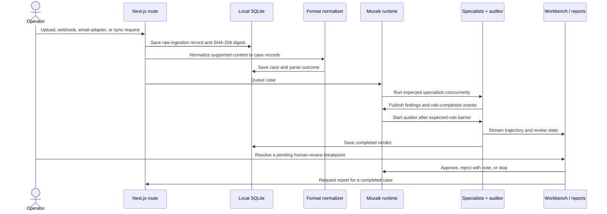

# 03 · System architecture and processing flow

## Request and execution path

The diagram shows the intended route flow; each input adapter has its own behavior and error handling. The raw-ingestion table stores payload content unencrypted. Agent activity and pending approvals are process-local, while case, verdict, and raw-ingestion records are stored in SQLite.

## Agent execution

For one case, the terms, FX, and wire specialists are expected; anomaly analysis is included when the case meets its trigger conditions. Those agents run concurrently. The auditor is activated after the expected specialists report completion and then calls deterministic audit tools. Cases from a batch are serialized by the orchestrator to limit contention on the configured model provider.

The provider model remains responsible for agent reasoning and tool selection. The TypeScript tools own the calculations they implement. The system does not independently authenticate supplied documents, guarantee correct extraction, or prove a finding solely from a citation string.

## Human review and outputs

The breakpoint handler can pause a case on risk findings or when step-tool review is configured. The operator can approve, reject and provide a steering note, or stop the case. An approval records the operator decision; it does not transmit funds or submit a dispute to a bank.

The UI streams events through `/api/events`, loads persisted history through `/api/history`, and serves available text/JSON report formats through `/api/report/[caseId]`.

## External services and local limits

- The FX tool queries Frankfurter's ECB reference-rate service and can use bundled fallback values.
- LLM inference requires a configured and reachable provider.
- The local timer, filesystem watcher, SQLite database, and in-memory agent runtime are designed for local evaluation. They are not a distributed production deployment.

See the [implementation architecture](../ARCHITECTURE.md) for the current API, connectors, persistence boundaries, and deployment limits.
