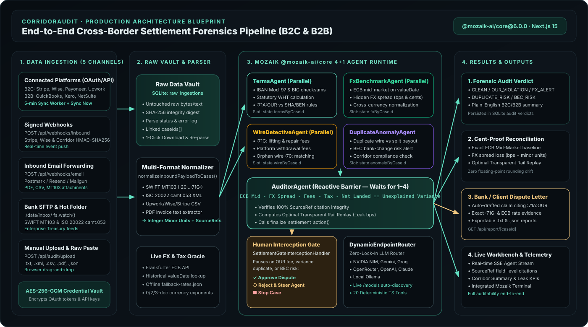

# 03 · End-to-End System Architecture & Processing Pipeline

## 1. Current Architecture Blueprint



---

## 2. End-to-End Pipeline Sequence

```mermaid
sequenceDiagram
    autonumber
    actor User as B2C User / B2B Employee / Platform
    participant Ingest as Ingestion Route / Sync Worker
    participant Vault as SQLite Raw Vault (raw_ingestions)
    participant Norm as Multi-Format Normalizer
    participant Mozaik as Mozaik Runtime (3 regular + conditional anomaly + auditor)
    participant Tools as TypeScript audit tools + ECB reference API
    participant Gate as SettlementGateInterceptionHandler
    participant UI as Live Workbench & Reports

    User->>Ingest: Upload file / Webhook / Email / Platform Sync
    Ingest->>Vault: saveRawIngestion() + SHA-256 fingerprint
    Ingest->>Norm: normalizeInboundPayloadToCases()
    Norm-->>Vault: updateRawIngestionOutcome(caseIds, parsed)
    Ingest->>Mozaik: enqueueBatch(cases) -> publishCorridorEvent("case.queued")

    par Expected Specialists (3 regular; anomaly runs only when triggered)
        Mozaik->>Tools: TermsAgent (IBAN Mod-97, WHT, OUR check)
        Mozaik->>Tools: FxBenchmarkAgent (ECB rate, FX spread bps)
        Mozaik->>Tools: WireDetectiveAgent (:71G: fees, orphan match)
        Mozaik->>Tools: DuplicateAnomalyAgent (conditional duplicate/account-change checks)
    end

    Mozaik->>Mozaik: Expected-role barrier releases after expected specialists finish
    Mozaik->>Tools: AuditorAgent (Cent conservation + Optimal Rail Replay)
    Tools-->>Gate: Proposed action requires breakpoint decision?
    Gate-->>UI: Pause & emit breakpoint.paused (SSE)
    User->>Gate: Approve / Reject & Steer / Stop
    Gate-->>Mozaik: Resume & finalize_settlement_action()
    Mozaik-->>Vault: Persist verdict in SQLite
    Mozaik-->>UI: Stream verdict and conditional dispute draft
```

---

## 3. Hybrid Design Principle: Why Deterministic Tools + Mozaik AI?

| Responsibility | Handled By | Why? |
| :--- | :--- | :--- |
| **Money conversions, FX spread, supplied withholding inputs, IBAN Mod-97** | **TypeScript helpers (`src/core/money.ts`)** | Audit calculations use integer minor-unit amounts, but conversions use JavaScript numbers and rounding. Agent tool selection and narrative remain model-driven. |
| **Tool selection, summaries, steering, dispute drafts** | **Mozaik AI Agents (`@mozaik-ai/core`)** | Parsers extract supported formats. OCR or reliable extraction from arbitrary PDFs is not guaranteed. |
| **Model Routing and Discovery** | **`DynamicEndpointRouter`** | Routes to configured providers. Model discovery and execution depend on provider support, endpoint, and valid credentials. |
