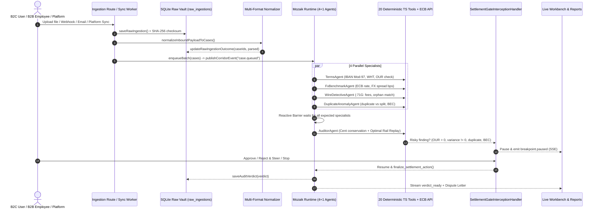

# 03 · End-to-End System Architecture & Processing Pipeline

## 1. Infographic Architecture Blueprint

---

## 2. End-to-End Pipeline Sequence

---

## 3. Hybrid Design Principle: Why Deterministic Tools + Mozaik AI?

| Responsibility | Handled By | Why? |
| :--- | :--- | :--- |
| **Currency math, FX spread bps, tax, IBAN Mod-97** | **Deterministic TypeScript (`src/core/money.ts`)** | LLMs must **never** do financial arithmetic; integer minor-unit math guarantees zero rounding drift. |
| **Unstructured parsing, reasoning, steering, dispute letters** | **Mozaik AI Agents (`@mozaik-ai/core`)** | Handles messy PDFs, stripped `:70:` remittance hints, plain-English explanations, and human "Reject & Steer" overrides. |
| **Live Model Routing & Auto-Discovery** | **`DynamicEndpointRouter`** | Supports NVIDIA NIM, Gemini, Groq, OpenRouter, OpenAI, Anthropic, and Ollama with live `/models` discovery. |
