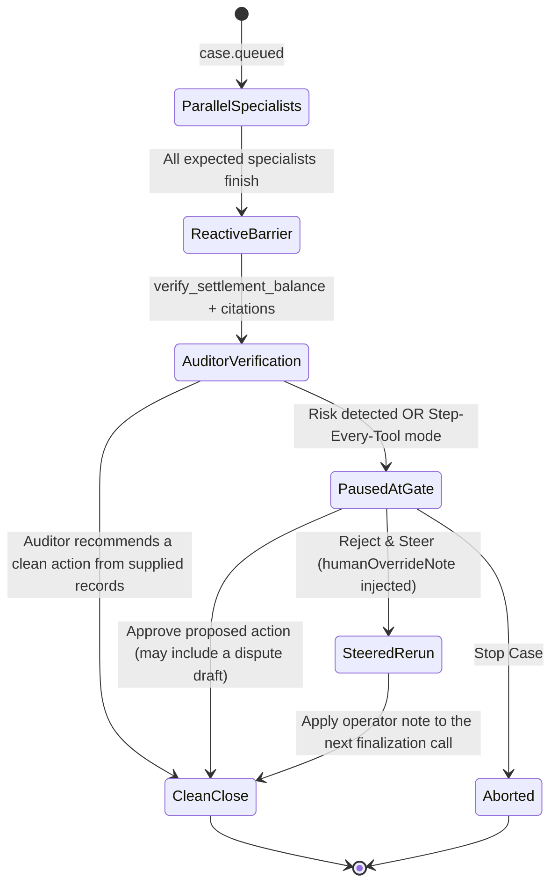

# 04 - The Mozaik Agent System: Three Parallel Specialists, Conditional Anomaly, Auditor

## 1. Infographic Agent Topology

---

## 2. Why `@mozaik-ai/core@6.0.0`?

CorridorAudit creates five Mozaik agents on `@mozaik-ai/core` in a shared `CorridorState` (`RuntimeState`):
1. **Parallel specialist work:** Expected specialists run concurrently for one case and write to role-specific maps (`termsByCaseId`, `fxByCaseId`, `wireByCaseId`, `anomalyByCaseId`). This is in-process state, not durable distributed execution.
2. **Expected-role barrier:** `markRoleComplete()` releases the auditor after every specialist expected for that case reports completion.
3. **Breakpoint review:** The interception handler can pause a proposed action for a human decision. Auto-approval can also be configured; a pause is not a universal sign-off on every case.

---

## 3. Agent Roles and Tool Inventory

| Agent | Execution Mode | Tools Owned | Isolated State Slot |
| :--- | :--- | :--- | :--- |
| **`TermsAgent`** | Parallel | `get_invoice_record`, `verify_invoice_line_items`, `validate_iban_bic_format`, `compute_tax_withholding`, `evaluate_fee_clause` | `state.termsByCaseId` |
| **`FxBenchmarkAgent`** | Parallel | `fetch_ecb_mid_market_rate`, `normalize_currency_amount`, `compute_fx_spread_minor`, `benchmark_corridor_fees` | `state.fxByCaseId` |
| **`WireDetectiveAgent`** | Parallel | `parse_wire_record`, `detect_repair_and_lifting_fees`, `match_orphan_wire`, `reconcile_split_payments` | `state.wireByCaseId` |
| **`DuplicateAnomalyAgent`** | Conditional Parallel | `scan_duplicate_wires`, `check_vendor_bank_change`, `screen_corridor_compliance` (heuristic flags, not regulatory screening) | `state.anomalyByCaseId` |
| **`AuditorAgent`** | Reactive (Barrier) | `verify_settlement_balance`, `verify_citations_integrity`, `simulate_corridor_replay`, `finalize_settlement_action` | `state.auditByCaseId` |

---

## 4. Human-in-the-Loop Breakpoint State Machine

