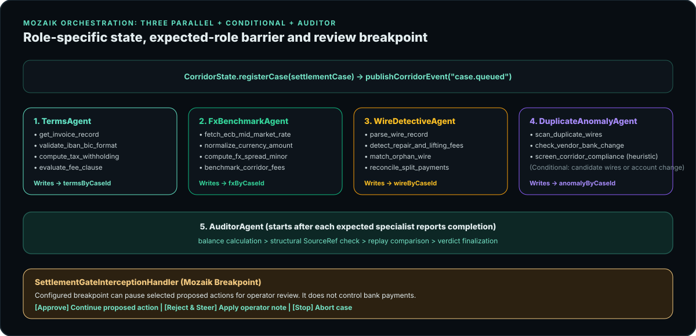
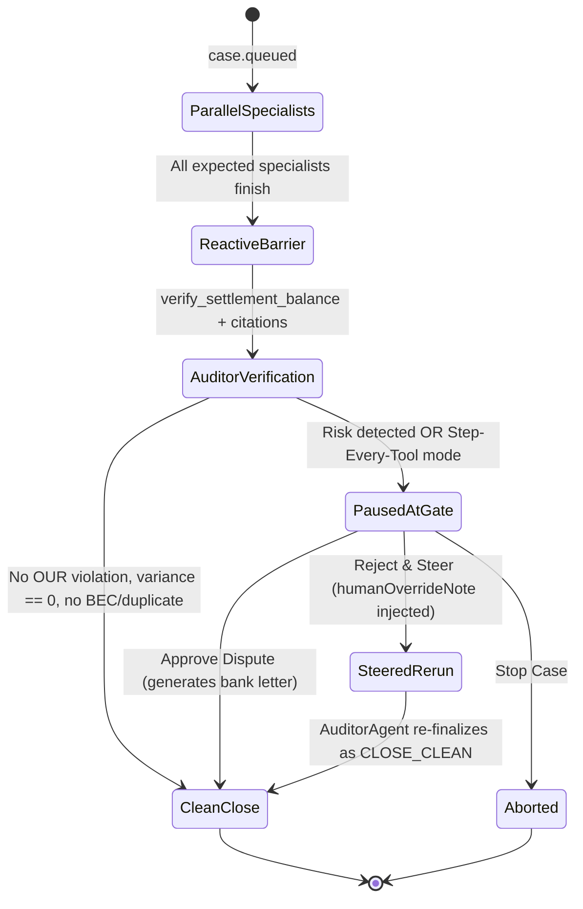

# 04 · The Mozaik 4+1 Concurrent Agent System

## 1. Infographic Agent Topology

---

## 2. Why `@mozaik-ai/core@6.0.0`?

CorridorAudit runs **5 real autonomous agents** on `@mozaik-ai/core` inside a shared `CorridorState` (`RuntimeState`):
1. **True Parallelism with Race-Free Isolation:** The 4 specialist agents run concurrently on the same case, each writing strictly to its own isolated map (`termsByCaseId`, `fxByCaseId`, `wireByCaseId`, `anomalyByCaseId`).
2. **Reactive Synchronization Barrier:** `AuditorAgent` does not poll; it activates via `CorridorState.markRoleComplete()` only after every expected specialist finishes.
3. **Interruptible Harness (`InterceptionHandler`):** Risky settlements pause mid-execution inside `finalize_settlement_action` until a human operator clicks **Approve**, **Reject & Steer**, or **Stop**.

---

## 3. Agent Roles & 20 Deterministic Tools

| Agent | Execution Mode | Tools Owned | Isolated State Slot |
| :--- | :--- | :--- | :--- |
| **`TermsAgent`** | Parallel | `get_invoice_record`, `verify_invoice_line_items`, `validate_iban_bic_format`, `compute_tax_withholding`, `evaluate_fee_clause` | `state.termsByCaseId` |
| **`FxBenchmarkAgent`** | Parallel | `fetch_ecb_mid_market_rate`, `normalize_currency_amount`, `compute_fx_spread_minor`, `benchmark_corridor_fees` | `state.fxByCaseId` |
| **`WireDetectiveAgent`** | Parallel | `parse_wire_record`, `detect_repair_and_lifting_fees`, `match_orphan_wire`, `reconcile_split_payments` | `state.wireByCaseId` |
| **`DuplicateAnomalyAgent`** | Conditional Parallel | `scan_duplicate_wires`, `check_vendor_bank_change`, `screen_corridor_compliance` | `state.anomalyByCaseId` |
| **`AuditorAgent`** | Reactive (Barrier) | `verify_settlement_balance`, `verify_citations_integrity`, `simulate_corridor_replay`, `finalize_settlement_action` | `state.auditByCaseId` |

---

## 4. Human-in-the-Loop Breakpoint State Machine

