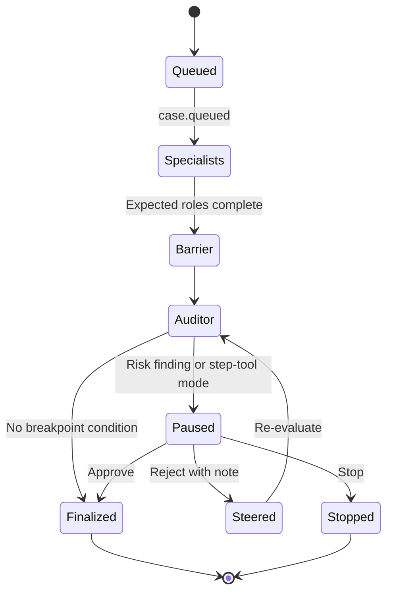

# 04 · Mozaik agent roles

CorridorAudit creates five peer agents using `@mozaik-ai/core@6.0.0`. Four specialists handle a case; the auditor starts after the expected specialist roles complete. This is a fixed, domain-specific agent workflow, not a general workflow builder.

## Roles and tool inventory

| Agent | Trigger | Tools |
| --- | --- | --- |
| `TermsAgent` | Expected for each case | `get_invoice_record`, `verify_invoice_line_items`, `validate_iban_bic_format`, `compute_tax_withholding`, `evaluate_fee_clause` |
| `FxBenchmarkAgent` | Expected for each case | `fetch_ecb_mid_market_rate`, `normalize_currency_amount`, `compute_fx_spread_minor`, `benchmark_corridor_fees` |
| `WireDetectiveAgent` | Expected for each case | `parse_wire_record`, `detect_repair_and_lifting_fees`, `match_orphan_wire`, `reconcile_split_payments` |
| `DuplicateAnomalyAgent` | Included for configured anomaly conditions | `scan_duplicate_wires`, `check_vendor_bank_change`, `screen_corridor_compliance` |
| `AuditorAgent` | After the expected specialists complete | `verify_settlement_balance`, `verify_citations_integrity`, `simulate_corridor_replay`, `finalize_settlement_action` |

The inventory contains twenty tools. Specialist results are written to role-specific case maps in [`src/runtime/corridor-runtime.ts`](../../src/runtime/corridor-runtime.ts). Case execution is serialized by the orchestrator; parallelism applies to the specialist agents within a case.

## Barrier and review gate

The configured gate supports operator decisions. It does not execute payment changes, validate an operator's legal authority, or provide a bank dispute channel. Steering is supplied as context to the auditor and does not guarantee that a finding changes.

## Model and deterministic-tool boundary

The selected LLM provider runs agent inference and chooses tool calls. Financial calculations, format checks, and case-state updates are implemented in TypeScript tools. Model reasoning and extracted input fields can still be wrong, and the current SourceRef check verifies structure rather than authenticating evidence. Operators must review source records and results.
