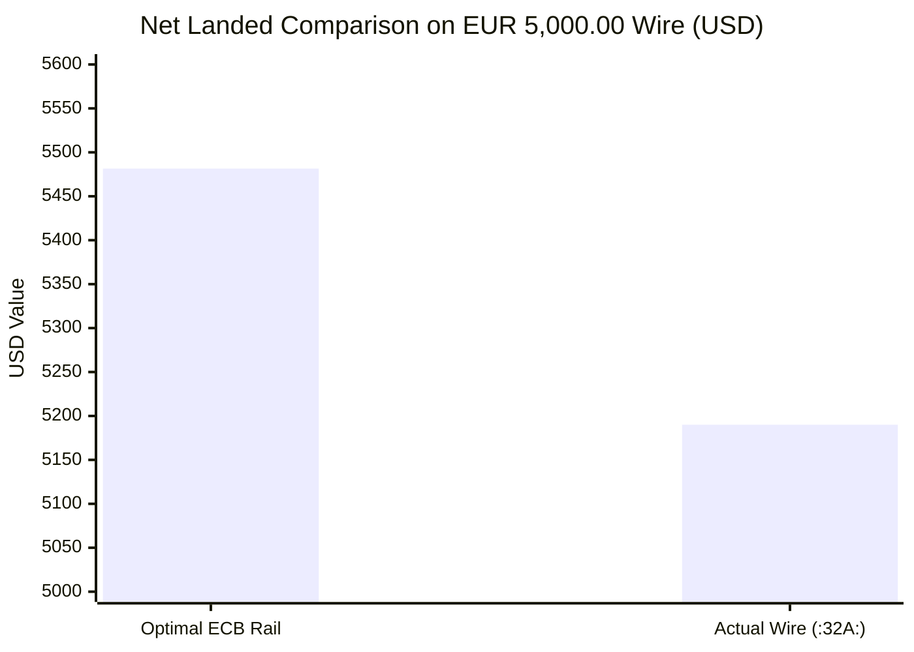

# 05 · Financial Mathematics & Forensic Algorithms

> [!IMPORTANT]
> Amounts and audit totals use integer minor units. Currency conversion uses JavaScript numeric rates and `Math.round`, so calculations are not arbitrary-precision decimal arithmetic.

---

## 1. Integer Minor-Unit Representation

The code explicitly assigns 0-decimal and selected 3-decimal currencies. Other currency codes default to 2 decimals, which should be verified before adding a currency:
- **0 decimals:** `JPY`, `KRW`, `VND` ($10^0$)
- **2 decimals:** `USD`, `EUR`, `GBP`, `INR`, `AUD`, `CAD`, `CHF`, `SGD` ($10^2$)
- **3 decimals:** `KWD`, `BHD`, `OMR`, `JOD` ($10^3$)

$$M = \text{intPart} \times 10^{e(c)} + \text{fracPart}_{\text{padded/truncated to } e(c)}$$

$$M_{\text{to}} = \text{round}\!\left(\frac{M_{\text{from}}}{10^{e(c_{\text{from}})}} \times r \times 10^{e(c_{\text{to}})}\right)$$

---

## 2. The Cent-Conservation Equation

$$\text{Variance} = M_{\text{ECB}} - M_{\text{FX\_Spread}} - M_{\text{Fees}} - M_{\text{WHT}} - M_{\text{Net\_Landed}}$$

A zero residual means the supplied values reconcile under this formula. It does not authenticate source records or prove that every real-world charge is explained.

---

## 3. FX Difference and OUR Fee Review Formulas

When `bankAppliedRate` is disclosed, the code compares the benchmark amount with the converted amount at that supplied rate:

$M_{\text{FX\_Spread}} = M_{\text{ECB}} - \text{convert}(M_{\text{gross}}, c_{\text{from}}, c_{\text{to}}, r_{\text{bank}})$

When `bankAppliedRate` is omitted, the estimate is derived from the reported credit and supplied deductions:

$M_{\text{FX\_Spread}} = M_{\text{ECB}} - (M_{\text{Net\_Landed}} + M_{\text{Fees}} + M_{\text{WHT}})$

$$\text{Spread}_{\text{bps}} = \text{round}\!\left(\frac{M_{\text{FX\_Spread}}}{M_{\text{ECB}}} \times 10{,}000\right)$$

Amount flagged for review when a supplied contract or wire bearer is `OUR` (an indicator, not a legal determination):

$M_{\text{Flagged}} = \begin{cases} M_{\text{Receiver\_Charges}} + M_{\text{Repair\_Fee}}, & \text{if supplied contract OR wire bearer is } \texttt{OUR} \\ 0, & \text{otherwise} \end{cases}$

---

## 4. Corridor Leak Replay Chart

---

## 5. Banking Identifier & Anomaly Algorithms

| Algorithm | Implementation | What It Detects |
| :--- | :--- | :--- |
| **IBAN Mod-97 (ISO 13616)** | `validateIbanMod97` | Rearranges first 4 chars to end, converts `A–Z → 10–35`, verifies $\bmod 97 = 1$. |
| **SWIFT BIC (ISO 9362)** | `validateBicFormat` | Validates 8- or 11-character ISO 9362 BIC structure. |
| **Orphan Wire Matching** | `match_orphan_wire` | Matches stripped `:70:` wires by currency, amount tolerance, sender, and date window. |
| **Duplicate vs. Split Payout** | `scan_duplicate_wires` | Heuristic classification of supplied candidate wires; review is needed to confirm payment intent. |
| **Account-Change Signal** | `check_vendor_bank_change` | Compares supplied beneficiary/account references; it does not verify who authorized a change. |
