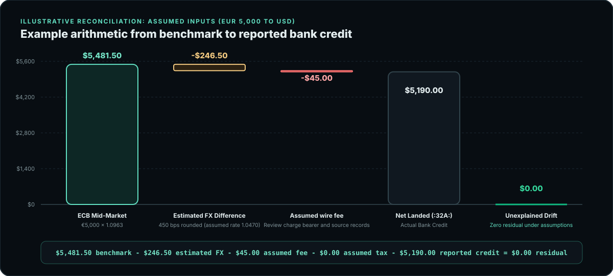
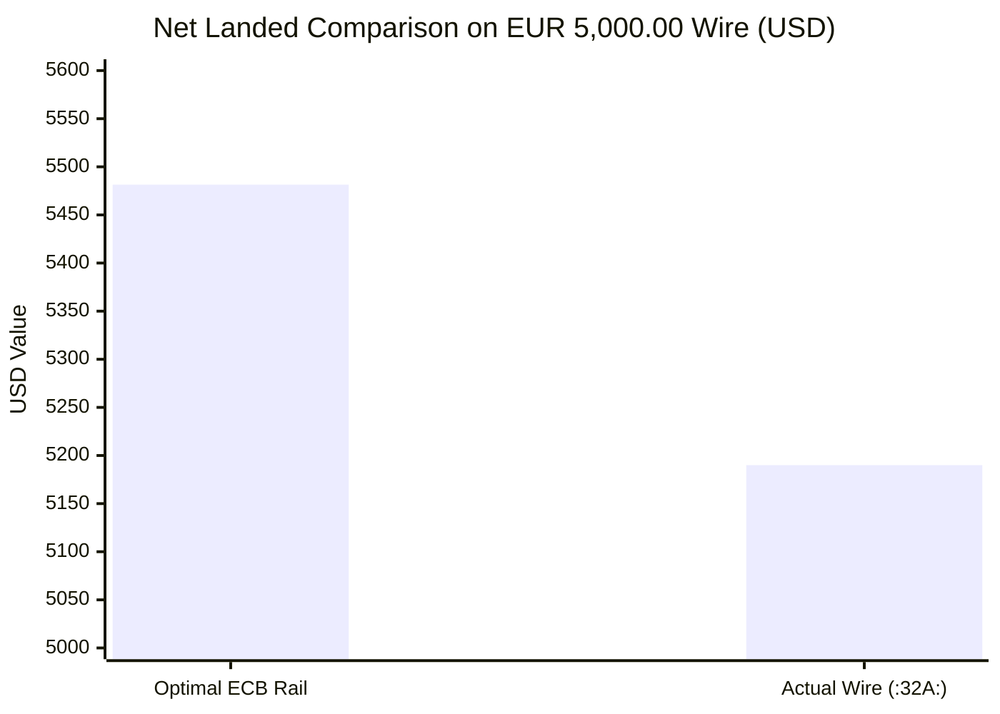

# 05 · Financial Mathematics & Forensic Algorithms

> [!IMPORTANT]
> Floating-point arithmetic (`0.1 + 0.2 === 0.30000000000000004`) is **banned** in CorridorAudit's accounting core ([`src/core/money.ts`](../../src/core/money.ts)). Every monetary calculation executes in **integer minor units**.

---

## 1. Integer Minor-Unit Representation

Each currency $c$ maps to an ISO 4217 minor exponent $e(c) \in \{0, 2, 3\}$:
- **0 decimals:** `JPY`, `KRW`, `VND` ($10^0$)
- **2 decimals:** `USD`, `EUR`, `GBP`, `INR`, `AUD`, `CAD`, `CHF`, `SGD` ($10^2$)
- **3 decimals:** `KWD`, `BHD`, `OMR`, `JOD` ($10^3$)

$$M = \text{intPart} \times 10^{e(c)} + \text{fracPart}_{\text{padded/truncated to } e(c)}$$

$$M_{\text{to}} = \text{round}\!\left(\frac{M_{\text{from}}}{10^{e(c_{\text{from}})}} \times r \times 10^{e(c_{\text{to}})}\right)$$

---

## 2. The Cent-Conservation Equation

$$\text{Variance} = M_{\text{ECB}} - M_{\text{FX\_Spread}} - M_{\text{Fees}} - M_{\text{WHT}} - M_{\text{Net\_Landed}}$$

If $\text{Variance} = 0$, **every single cent is accounted for** (zero drift).

---

## 3. Hidden FX Spread & `:71A:OUR` Violation Formulas

When `bankAppliedRate` ($r_{\text{bank}}$) is disclosed (`:36:`):

$$M_{\text{FX\_Spread}} = \max\!\big(0,\; M_{\text{ECB}} - \text{convert}(M_{\text{gross}}, c_{\text{from}}, c_{\text{to}}, r_{\text{bank}})\big)$$

When `bankAppliedRate` is omitted:

$$M_{\text{FX\_Spread}} = \max\!\big(0,\; M_{\text{ECB}} - (M_{\text{Net\_Landed}} + M_{\text{Fees}} + M_{\text{WHT}})\big)$$

$$\text{Spread}_{\text{bps}} = \text{round}\!\left(\frac{M_{\text{FX\_Spread}}}{M_{\text{ECB}}} \times 10{,}000\right)$$

Recoverable `:71A:OUR` fee violation:

$$M_{\text{Recoverable}} = \begin{cases} M_{\text{Receiver\_Charges}} + M_{\text{Repair\_Fee}}, & \text{if } \text{contractedBearer} = \texttt{OUR} \\ 0, & \text{otherwise} \end{cases}$$

---

## 4. Corridor Leak Replay Chart

---

## 5. Banking Identifier & Anomaly Algorithms

| Algorithm | Implementation | What It Detects |
| :--- | :--- | :--- |
| **IBAN Mod-97 (ISO 13616)** | `validateIbanMod97` | Rearranges first 4 chars to end, converts `A–Z → 10–35`, verifies $\bmod 97 = 1$. |
| **SWIFT BIC (ISO 9362)** | `validateBicFormat` | Validates 8- or 11-character ISO 9362 BIC structure. |
| **Orphan Wire Matching** | `match_orphan_wire` | Matches stripped `:70:` wires by currency, amount tolerance, sender, and date window. |
| **Duplicate vs. Split Payout** | `scan_duplicate_wires` | Separates duplicate retries from legitimate split installments. |
| **BEC Bank-Change Risk** | `check_vendor_bank_change` | Flags beneficiary IBAN changes against `priorAccountRef`. |
