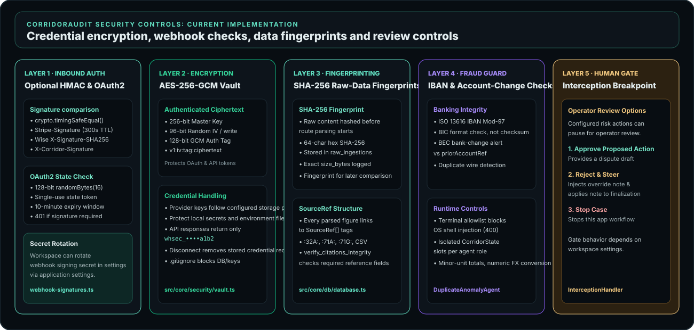
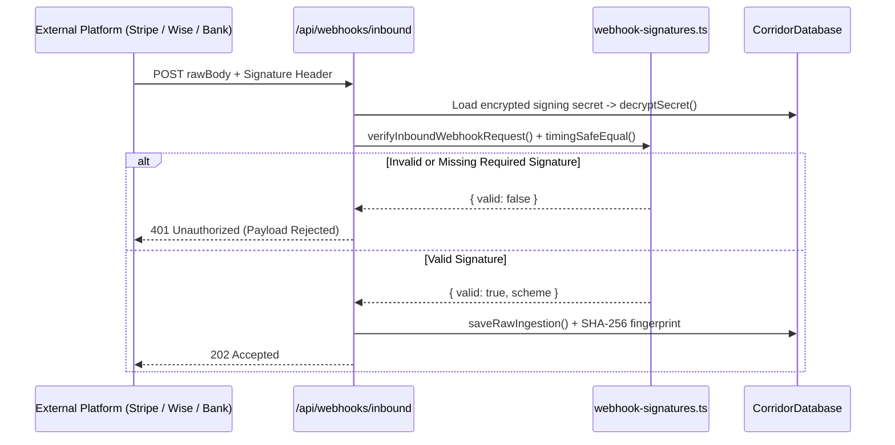

# 07 · Security, Cryptography, Hashing & Sensitive Data Protection

> [!IMPORTANT]
> As a financial forensics platform handling bank statements, OAuth tokens, API keys, and payment webhooks, **CorridorAudit** enforces a **5-layer defense-in-depth security model** across ingress, encryption at rest, cryptographic hashing, runtime sandboxing, and human-in-the-loop governance.

---

## 1. Layer 1 · Inbound Webhook Authentication (`HMAC-SHA256`)

Implemented in [`src/core/security/webhook-signatures.ts`](../../src/core/security/webhook-signatures.ts):

- **Constant-Time Comparison:** Every signature check uses Node's `crypto.timingSafeEqual(bufA, bufB)` to prevent timing side-channel attacks.
- **Multi-Provider Signature Schemes:**
  - **Stripe (`Stripe-Signature`):** Verifies `t=<unix>,v1=<hex>` over `${timestamp}.${rawBody}` and enforces a **300-second replay-attack tolerance window**.
  - **Wise (`X-Signature-SHA256`):** Verifies HMAC-SHA256 (Hex or Base64) of the raw request body.
  - **CorridorAudit (`X-Corridor-Signature`):** Verifies `sha256=<hex>` against the workspace's encrypted signing secret.
- **Strict Enforcement Toggle:** Enabling **Require valid HMAC signature** in **System Settings → Team & Webhook Security** rejects all unsigned `POST /api/webhooks/inbound` and `POST /api/webhooks/email` requests with `401 Unauthorized`.

---

## 2. Layer 2 · Authenticated Encryption at Rest (`AES-256-GCM`)

Implemented in [`src/core/security/vault.ts`](../../src/core/security/vault.ts):

| Property | Implementation Detail |
| :--- | :--- |
| **Cipher** | `aes-256-gcm` (authenticated encryption with associated integrity tag) |
| **Master Key** | 256-bit key from `CORRIDOR_VAULT_KEY` env var or auto-generated `0600` key in `data/.vault-key` |
| **Initialization Vector** | Fresh 96-bit (`12`-byte) `crypto.randomBytes(12)` generated per encryption call |
| **Wire Format** | `v1:<iv_base64>:<auth_tag_base64>:<ciphertext_base64>` |
| **Protected Secrets** | OAuth2 `accessToken`, `refreshToken`, platform `apiKey`, `webhookSecret`, and workspace signing secrets |

---

## 3. Layer 3 · Zero-Leakage Sensitive Data Protection

1. **API & UI Secret Masking (`maskSecret`):** `GET /api/integrations` and `GET /api/settings/workspace` never return plaintext secrets — only masked prefixes/suffixes (`whsec_••••a1b2`), and **Disconnect** wipes `credentials_enc = NULL` in SQLite.
2. **In-Memory LLM API Keys:** Keys entered in **System Settings** live strictly in server RAM (`DynamicEndpointRouter`) — never written to `.env`, SQLite, or Git.
3. **Git & Repository Hygiene (`.gitignore`):** Excludes `.env*`, `data/corridoraudit.db*`, `data/.vault-key`, and `data/inbox/`.
4. **OAuth2 CSRF Protection (`src/core/integrations/oauth.ts`):** Uses 128-bit `randomBytes(16)` single-use CSRF `state` tokens with a 10-minute expiration window.

---

## 4. Layer 4 · Cryptographic Fingerprinting (`SHA-256` Raw Data Vault)

Every inbound file, webhook, email, platform sync, or hot-folder drop is hashed **before any parser runs** (`createHash("sha256")`) and stored in `raw_ingestions` for tamper-evident non-repudiation, paired with `verify_citations_integrity` for field-level `SourceRef[]` provenance.

---

## 5. Layer 5 · Fraud, Injection & Human-Gate Safeguards

- **BEC Bank-Change & Duplicate Shield:** `DuplicateAnomalyAgent` compares incoming beneficiary IBANs against `priorAccountRef` and separates duplicate retries from split installments.
- **IBAN Mod-97 & SWIFT BIC Checksums:** Deterministic ISO 13616 / ISO 9362 validation catches corrupted routing identifiers.
- **Integrated Console Allowlist (`POST /api/terminal`):** Rejects arbitrary shell commands (`400`) and executes strictly against the Mozaik runtime.
- **`SettlementGateInterceptionHandler`:** Pauses execution on any recoverable fee, variance, duplicate, or BEC risk for explicit human **Approve**, **Reject & Steer**, or **Stop**.
