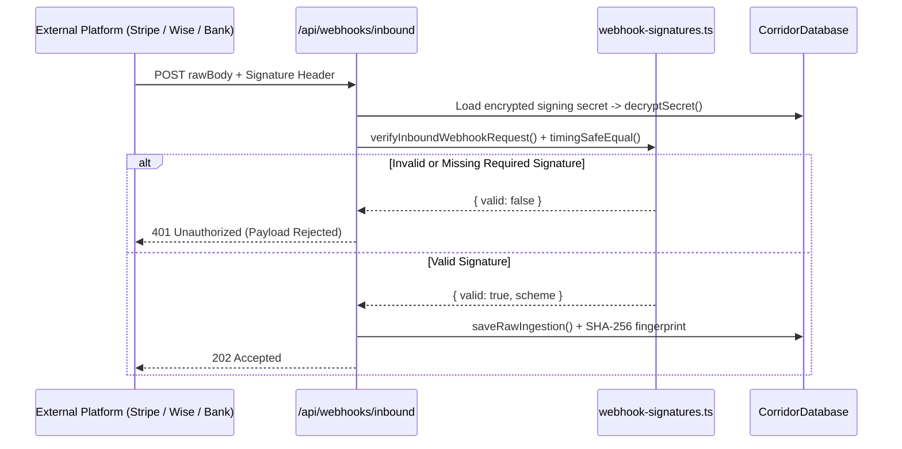

# 07 · Security, Cryptography, Hashing & Sensitive Data Protection

> [!IMPORTANT]
> CorridorAudit includes the controls documented below. The local prototype does not implement a complete production security program, user authentication, or multi-tenant authorization.

---

## 1. Layer 1 · Inbound Webhook Authentication (`HMAC-SHA256`)

Implemented in [`src/core/security/webhook-signatures.ts`](../../src/core/security/webhook-signatures.ts):

- **Constant-Time Comparison:** Every signature check uses Node's `crypto.timingSafeEqual(bufA, bufB)` to prevent timing side-channel attacks.
- **Multi-Provider Signature Schemes:**
  - **Stripe (`Stripe-Signature`):** Verifies `t=<unix>,v1=<hex>` over `${timestamp}.${rawBody}` and enforces a **300-second replay-attack tolerance window**.
  - **Wise (`X-Signature-SHA256`):** Verifies HMAC-SHA256 (Hex or Base64) of the raw request body.
  - **CorridorAudit (`X-Corridor-Signature`):** Verifies `sha256=<hex>` against the workspace's encrypted signing secret.
- **Configurable enforcement:** Signature enforcement is disabled by default. When enabled, recognized unsigned or invalid signatures are rejected with `401 Unauthorized`.

---

## 2. Layer 2 · Authenticated Encryption at Rest (`AES-256-GCM`)

Implemented in [`src/core/security/vault.ts`](../../src/core/security/vault.ts):

| Property | Implementation Detail |
| :--- | :--- |
| **Cipher** | `aes-256-gcm` (authenticated encryption with associated integrity tag) |
| **Master Key** | 32-byte key from `CORRIDOR_VAULT_KEY` or generated local `data/.vault-key`; file permissions depend on host OS |
| **Initialization Vector** | Fresh 96-bit (`12`-byte) `crypto.randomBytes(12)` generated per encryption call |
| **Wire Format** | `v1:<iv_base64>:<auth_tag_base64>:<ciphertext_base64>` |
| **Protected Secrets** | OAuth2 `accessToken`, `refreshToken`, platform `apiKey`, `webhookSecret`, and workspace signing secrets |

---

## 3. Layer 3 - Secret Handling and OAuth State

1. **API & UI Secret Masking (`maskSecret`):** Integration responses mask saved credentials. Disconnect removes the stored encrypted credential record.
2. **LLM Provider Keys:** Storage and lifetime depend on the provider configuration path. Do not assume every key exists only in server RAM; verify active settings and environment configuration.
3. **Git & Repository Hygiene (`.gitignore`):** Excludes `.env*`, `data/corridoraudit.db*`, `data/.vault-key`, and `data/inbox/`.
4. **OAuth2 State Check (`src/core/integrations/oauth.ts`):** Uses random single-use `state` values held in process memory with a 10-minute expiration. This is not a distributed or durable session store.

---

## 4. Layer 4 - SHA-256 Ingestion Fingerprints

Implemented ingestion routes store raw content and a SHA-256 digest before parsing. Comparing a later digest can reveal content changes, but the SQLite row is editable and is not an immutable or non-repudiation system. `verify_citations_integrity` checks SourceRef fields and excerpts structurally; it does not authenticate the underlying documents.

---

## 5. Layer 5 - Heuristic Checks and Human Review

- **Account-Change and Duplicate Signals:** `DuplicateAnomalyAgent` compares supplied account references and candidate wires. These heuristic checks require complete, trusted input and do not block a payment.
- **Identifier Checks:** IBAN Mod-97 checksum and BIC format checks can catch some malformed values. BIC is not a checksum or bank-account ownership check.
- **Integrated Console Allowlist (`POST /api/terminal`):** Rejects arbitrary shell commands (`400`) and executes strictly against the Mozaik runtime.
- **`SettlementGateInterceptionHandler`:** Can pause selected proposed audit actions for **Approve**, **Reject & Steer**, or **Stop**. It does not authorize, submit, or reverse bank transfers.
