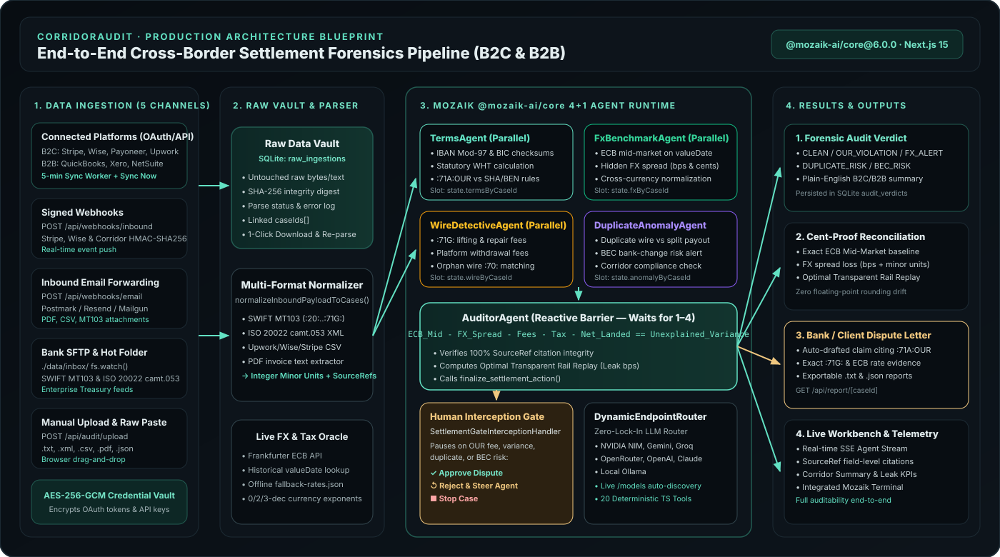

# CorridorAudit — End-to-End Engineering & Product Case Study

> [!IMPORTANT]
> **CorridorAudit** is an autonomous, human-gated cross-border settlement forensics platform built on **Next.js 15 (TypeScript)** and **Mozaik (`@mozaik-ai/core@6.0.0`)** for both **B2C freelancers/contractors** and **B2B finance/treasury teams**.

---

## Case Study Navigation Tiles

| Module | Focus Area | Key Artifacts & Visuals |
| :--- | :--- | :--- |
| **[01. Problem Statement](./01-problem-statement.md)** | Why cross-border payouts leak 3%–7% silently across B2C & B2B | Leak taxonomy, B2C vs B2B matrix, cost impact chart |
| **[02. Data Ingestion & Raw Vault](./02-data-ingestion-and-raw-vault.md)** | All 5 live channels, 12 vendor platforms, AES-256 vault & `raw_ingestions` | Channel diagram, platform table, SHA-256 vault schema |
| **[03. System Architecture & Pipeline](./03-system-architecture-and-pipeline.md)** | Full Input → Vault → Mozaik → Gate → Output blueprint | Infographic SVG blueprint + Mermaid sequence & flow |
| **[04. Mozaik 4+1 Agent System](./04-mozaik-4-plus-1-agents.md)** | Why `@mozaik-ai/core`, 4+1 concurrent agents, `CorridorState`, breakpoints | 4+1 Topology SVG + Mermaid state machine & router |
| **[05. Financial Math & Algorithms](./05-algorithms-and-financial-math.md)** | Zero-drift integer minor units, Cent-Conservation Equation, Mod-97, FX bps | Mathematical proofs, waterfall SVG, algorithm specs |
| **[06. Outputs, Disputes & ROI](./06-outputs-disputes-and-roi.md)** | Exact user deliverables, worked `€5,000` EUR→USD case, dispute letters, ROI | Worked ledger example, dispute template, B2C/B2B ROI |
| **[07. Security, Hashing & Data Protection](./07-security-hashing-and-data-protection.md)** | AES-256-GCM vault, HMAC-SHA256 webhooks, SHA-256 fingerprints & BEC guard | 5-Layer Security SVG, webhook sequence & zero-leak policy |

---

## System Blueprint at a Glance

---

## Executive Snapshot (Key Engineering Guarantees)

| Guarantee | Implementation | Where in Code |
| :--- | :--- | :--- |
| **Zero LLM Math Hallucination** | 100% of currency math, FX spread, tax, and IBAN Mod-97 run in deterministic TypeScript minor-unit functions | [`src/core/money.ts`](../../src/core/money.ts) |
| **Immutable Raw Evidence** | Every upload, webhook, email, platform sync, and hot-folder file is stored untouched with SHA-256 before parsing | [`src/core/db/database.ts`](../../src/core/db/database.ts) |
| **4+1 Concurrent Mozaik Agents** | 4 specialists execute concurrently in isolated state slots; `AuditorAgent` waits on a reactive barrier | [`src/runtime/agents/corridor-agents.ts`](../../src/runtime/agents/corridor-agents.ts) |
| **Human-in-the-Loop Safety** | `SettlementGateInterceptionHandler` pauses risky claims for **Approve**, **Reject & Steer**, or **Stop** | [`src/runtime/interception/`](../../src/runtime/interception/) |
| **Zero LLM Vendor Lock-In** | `DynamicEndpointRouter` supports NVIDIA NIM, Gemini, Groq, OpenRouter, OpenAI, Anthropic, and Ollama + live `/models` discovery | [`src/core/llm/providers.ts`](../../src/core/llm/providers.ts) |
| **Encrypted Credential Storage** | OAuth2 tokens & API keys are encrypted at rest with AES-256-GCM; webhooks verified via HMAC-SHA256 | [`src/core/security/vault.ts`](../../src/core/security/vault.ts) |
