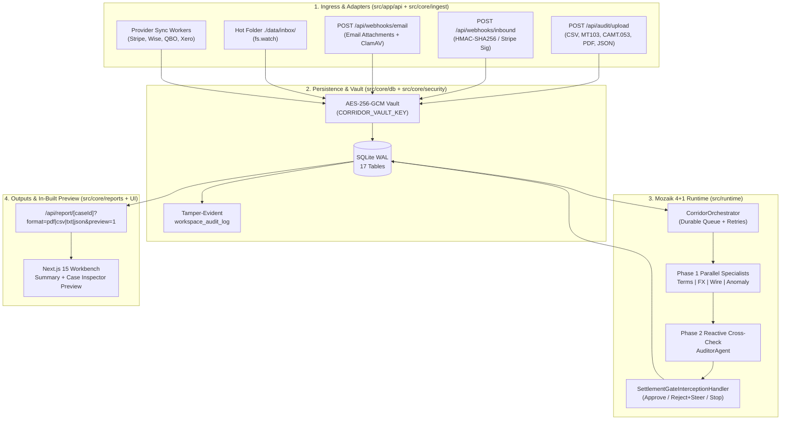

# CorridorAudit Developer Engineering Documentation

Welcome to the **CorridorAudit** technical engineering reference. These documents are grounded directly in the TypeScript codebase (`src/`), SQLite schema (`src/core/db/schema.ts`), Mozaik runtime (`@mozaik-ai/core@6.0.0`), and test suite (`tests/`).

## System Architecture Overview

---

## Developer Reference Modules

| Document | Scope |
| :--- | :--- |
| **[API Endpoints Reference](./api-reference.md)** | All 29 `/api/*` route files, HTTP methods, RBAC roles, request/response contracts, and `?format=pdf\|csv\|txt\|json&preview=1` |
| **[Database Schema & Vault](./database-schema.md)** | All 17 SQLite tables, columns, foreign keys, leases, WAL backup, and AES-256-GCM encryption boundaries |
| **[Codebase Module Map](./module-map.md)** | Complete file-by-file map of `src/core/`, `src/runtime/`, `src/components/`, `src/operations/`, and `tests/` |
| **[Environment & Security Config](./env-and-security.md)** | Every `.env` variable, Cognito/local RBAC, SSRF DNS pinning, webhook signatures, and ClamAV scanning |
| **[Bug Fixes — 2026-11-27](./bug-fixes-2026-11-27.md)** | Root-cause analysis, code diffs, and verification for six production-affecting UI/runtime/export bugs fixed for hackathon submission |

---

## Related Documentation
- **Product & Judge Case Study:** [`docs/Case Study/README.md`](../Case%20Study/README.md)
- **Implementation Architecture:** [`docs/ARCHITECTURE.md`](../ARCHITECTURE.md)
- **Production Operations & Status:** [`docs/production/README.md`](../production/README.md)
- **Versioning & Changelog:** [`docs/VERSIONING.md`](../VERSIONING.md) · [`CHANGELOG.md`](../../CHANGELOG.md)
