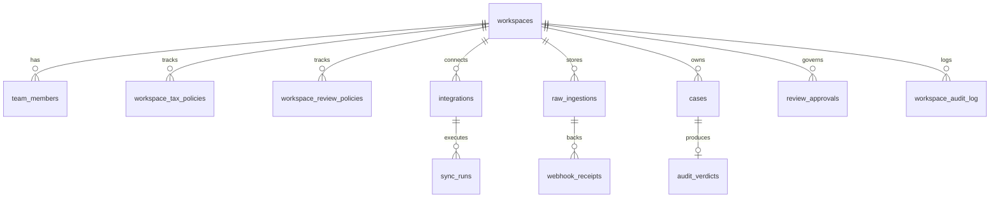

# Database Schema & Encryption Vault (`src/core/db/`)

CorridorAudit uses Node.js 22.5+ built-in `node:sqlite` (`DatabaseSync`) with `PRAGMA journal_mode = WAL;` and `PRAGMA foreign_keys = ON;`. The schema is defined in [`src/core/db/schema.ts`](../../src/core/db/schema.ts) and managed by `CorridorDatabase` in [`src/core/db/database.ts`](../../src/core/db/database.ts).

---

## Entity Relationship Diagram

---

## All 17 SQLite Tables

### 1. Workspace, Team & Policy Tables
| Table | Primary Key | Encrypted Fields / Notes |
| :--- | :--- | :--- |
| `workspaces` | `id` | Stores `account_mode` (`b2b`/`b2c`), `default_currency`, `tax_country`, `withholding_tax_bps`, `variance_threshold_minor`, `inbound_email_address`, and AES-256-GCM encrypted `webhook_signing_secret_enc`. |
| `team_members` | `id` | `workspace_id`, `identity_sub` (Cognito `sub`), `email`, `name`, `role` (`owner`/`controller`/`analyst`/`viewer`), `status` (`active`/`invited`). |
| `auth_sessions` | `session_id` | Tracks `identity_sub`, `issued_at`, `expires_at`, and `revoked_at` (indexed on `expires_at`). |
| `workspace_tax_policies` | `id` | Historical/active withholding tax policy snapshots (`country`, `withholding_tax_bps`, `effective_at`). |
| `workspace_review_policies` | `id` | Human-review threshold policy snapshots (`variance_threshold_minor`, `threshold_unit`). |

### 2. Ingestion, Cases, Verdicts & Approvals
| Table | Primary Key | Encrypted Fields / Notes |
| :--- | :--- | :--- |
| `raw_ingestions` | `id` | Immutable-intent Raw Data Vault. Stores `sha256`, `size_bytes`, `source_channel`, `format`, `parse_status`, `case_ids_json`, plus AES-256-GCM encrypted `raw_content` (`raw_content_encrypted`), `filename`, `metadata_json`, and `parse_error`. |
| `webhook_receipts` | `(workspace_id, provider, event_id)` | Idempotency & concurrency lock table. Stores `payload_sha256` (`409` on mismatch), `ingestion_id`, `status`, `processing_owner`, and `processing_lease_expires_at`. |
| `cases` | `case_id` | Durable job queue + normalized case store. Stores `status` (`queued`, etc.), `attempt_count`, `next_attempt_at`, `worker_id`, `lease_expires_at`, `submitted_by_sub`, and AES-256-GCM encrypted `payload_json` (`payload_json_encrypted`). |
| `audit_verdicts` | `case_id` | Final verdict per case (`status`, `completed_at`) with AES-256-GCM encrypted `verdict_json` (`verdict_json_encrypted`). |
| `review_approvals` | `id` | Breakpoint decisions bound to `args_sha256`, `case_evidence_sha256`, `review_policy_id`, `expires_at`, `reviewer_sub`/`email`/`role`, and encrypted `pending_json` (`pending_json_encrypted`). |

### 3. Integrations, OAuth & Concurrency Leases
| Table | Primary Key | Purpose |
| :--- | :--- | :--- |
| `integrations` | `id` (`UNIQUE(workspace_id, provider)`) | Connected providers (`stripe`, `wise`, `quickbooks`, `xero`, etc.) with AES-256-GCM encrypted `credentials_enc`, `last_synced_at`, `last_full_synced_at`, `last_full_sync_attempt_at`. |
| `oauth_authorization_states` | `state` | Single-use OAuth state & encrypted PKCE `code_verifier_enc` with `expires_at`. |
| `integration_refresh_leases` | `(workspace_id, provider)` | Distributed-safe SQLite lease (`owner_id`, `lease_expires_at`) serializing OAuth token refresh. |
| `integration_sync_leases` | `(workspace_id, provider)` | SQLite lease serializing concurrent provider sync runs. |
| `sync_runs` | `id` | History of `manual`, `cron`, and `webhook` syncs (`records_fetched`, `cases_queued`, `case_ids_json`, `error`). |

### 4. Security, Rate Limiting & Tamper-Evident Audit Log
| Table | Primary Key | Purpose |
| :--- | :--- | :--- |
| `api_rate_limit_buckets` | `bucket_key` | Atomic fixed-window API rate limiter (`window_start_ms`, `request_count`, indexed on `window_start_ms`). |
| `workspace_audit_log` | `(workspace_id, sequence)` | Append-only hash-chained audit trail (`previous_hash`, `event_hash`, `actor_*`, `action`, `target_*`, `outcome`). Any local DB edit breaks the SHA-256 chain verification. |

---

## Vault Encryption & Backups
- **AES-256-GCM Vault ([`src/core/security/vault.ts`](../../src/core/security/vault.ts)):** Encrypts credentials, raw ingestion payloads, case payloads, verdicts, pending approvals, and OAuth PKCE verifiers using `CORRIDOR_VAULT_KEY` (64-char hex 32-byte key required in production).
- **WAL-Safe Backups ([`src/core/db/backup.ts`](../../src/core/db/backup.ts), `npm run db:backup`):** Uses SQLite online backup / WAL checkpointing and runs `PRAGMA integrity_check` on the backup file.
