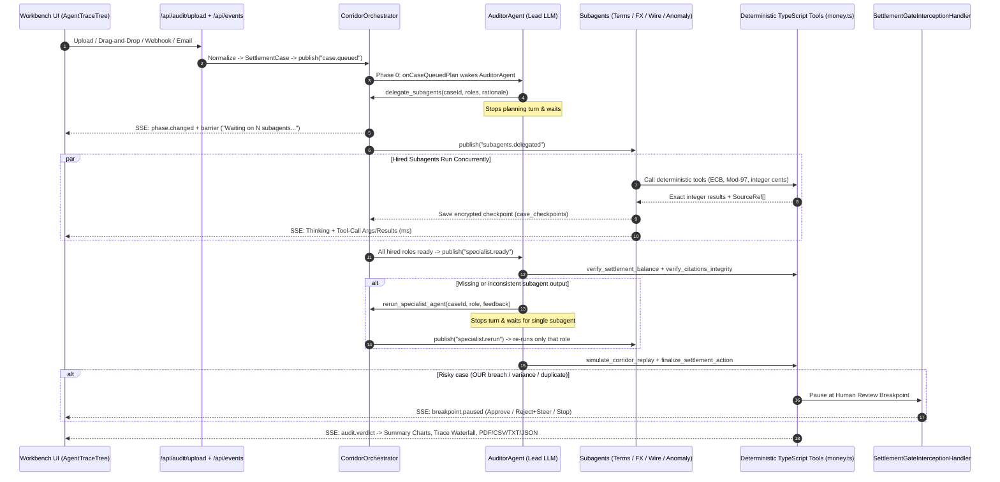

# Dynamic Execution Layer (`@mozaik-ai/core@6.0.0`)

This document explains how **CorridorAudit** executes audits end-to-end across **Phase 0 (Lead-LLM Planning)**, **Phase 1 (Parallel Subagents)**, **Phase 2 (Verification, Self-Healing & Breakpoint Gate)**, and the **`AgentTraceTree` SSE Stream**.

---

## End-to-End Execution Sequence

---

## 1. Phase 0 — Lead-LLM Dynamic Planning (`onCaseQueuedPlan`)
- When a case arrives (`case.queued`), `CorridorState.registerCase()` initializes `expectedRolesByCaseId` as empty (unless checkpoints are restored from SQLite).
- **`AuditorAgent`** (`src/runtime/agents/corridor-agents.ts`) wakes first, reads the normalized case summary, and calls **`delegate_subagents({ caseId, roles, rationale })`** (`src/runtime/tools/audit-tools.ts`) to hire only the needed roles (`"terms"`, `"fx"`, `"wire"`, `"anomaly"`).
- `AuditorAgent` immediately stops its planning turn and waits.

---

## 2. Phase 1 — Parallel Subagent Execution (`subagents.delegated`)
- Hired subagents wake simultaneously in isolated `ModelContext`s and write only to their own per-role slot in `CorridorState` (`termsByCaseId`, `fxByCaseId`, `wireByCaseId`, `anomalyByCaseId`) — eliminating race conditions.
- **Zero LLM Arithmetic:** Subagents decide *which* tools to invoke; deterministic TypeScript tools (`src/core/money.ts`) perform 100% of the currency math and ECB lookups.
- As each subagent finishes, `trajectory-observer.ts` persists an **AES-256-GCM encrypted checkpoint** to SQLite (`case_checkpoints`) so retries/restarts never repeat finished work.

---

## 3. Phase 2 — Barrier, Targeted Self-Healing & Breakpoint Gate
- **`onAllSpecialistsReady`** triggers `AuditorAgent` once every hired role is present in `findingsByRole`.
- `AuditorAgent` runs `verify_settlement_balance` and `verify_citations_integrity`:
  - If satisfied → proceeds directly to `simulate_corridor_replay` and `finalize_settlement_action`.
  - If a specialist failed or missed evidence → calls `rerun_specialist_agent(caseId, role, feedback)` (tracking `previousFeedbacks` with no hard retry cap; `AuditorAgent` waits and decides when to stop).
- High-risk verdicts pause at `SettlementGateInterceptionHandler` (`Approve`, `Reject & Steer`, `Stop`) before publishing `AuditVerdict`.

---

## 4. Live UI Representation (`AgentTraceTree`)
- **`src/components/agent-trace-tree.tsx`** renders the live SSE stream as a collapsible tree:
  - Root summary toggle (`Working (Xs)...` → `Worked for Xs · N agents, M tools, K thoughts`) + `Expand all` / `Collapse all`.
  - Live parallel barrier row (`Waiting on N subagents (done/total joined)...`).
  - Expandable `Subagent` / `Lead Agent` branches with nested `Thinking` and `ARGS` / `RESULT` tool-call cards.
