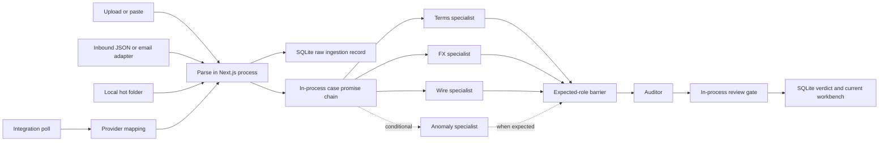

# Current Behavior and Gaps

This page records behavior visible in the current source tree. It distinguishes persisted data from process-local state and provider-specific code from catalog entries.

## Current request and processing flow

Uploads and inbound webhooks parse in the request process. Upload and webhook bodies have endpoint-specific streaming size limits. The API normally returns `202` after parsing and starting an in-process queue operation, not after the audit finishes. Three specialist agents run concurrently per case. The anomaly agent runs when candidate wires or account-change evidence is present. The auditor starts after all expected specialists complete. Cases are serialized through a process-local promise chain. See [`src/runtime/orchestrator.ts`](../../src/runtime/orchestrator.ts).

## Feature status

| Area | Implemented now | Production gap |
| --- | --- | --- |
| Data Sources | Upload, text paste, JSON webhook, email-adapter JSON, local hot folder, and integration catalog. Stripe, Wise, QuickBooks Online, and Xero have provider-specific polling with bounded page traversal and raw response retention. Expired Wise, QuickBooks, Xero, and TrueLayer OAuth tokens refresh before sync, with new credentials encrypted and saved. | Polling still lacks incremental cursors, provider revocation, full payment matching, and provider conformance. Refresh coordination is process-local and is not safe across multiple app instances. Other catalog options may use a generic JSON endpoint, local folder, or setup-only record. |
| Raw and normalized financial records | Raw payloads, case JSON, verdict JSON, pending approval payloads, and integration credentials are encrypted in SQLite through the AES-256-GCM vault. Legacy payload rows are encrypted in place on database open. Local development can use a persistent key file; production refuses to create a local key and requires `CORRIDOR_VAULT_KEY`. Raw-record reads and updates include workspace scope, and case/verdict writes reject case-ID ownership conflicts across workspaces. Existing routes decrypt records for inspect, download, reprocess, and case loading. Upload and webhook request sizes are bounded. Provider sync retains fetched response pages. | API routing and login still select the fixed `ws-default`; workspace selection from verified identity is not implemented. Production key handling is not yet integrated with AWS KMS or a managed secret provider. Case IDs, titles, sync errors, some ingestion metadata, event identifiers, and other operational columns remain plaintext. A digest stored beside an editable database row is not tamper evidence. Generic endpoints and local folder adapters may still preserve normalized cases rather than provider originals. Key rotation, malware scanning, retention, and immutable evidence custody are missing. |
| Corridor summary | UI totals saved verdict fields and lists cases. Evidence-incomplete invoice-only cases are excluded from fee and FX totals. Fee and FX labels describe calculated flags and estimates. | Summary is not grouped into a complete corridor analytics model. Amount flags are not independently verified recoveries. Zero variance is arithmetic over submitted values, not proof that source records are authentic. |
| Review gate | Risk-only and every-tool modes. Risk Only pauses for recoverable OUR fee flags, above-threshold variance, duplicate classification, or supplied bank-change signal. Nonzero below-threshold differences remain visible in the verdict. Variance thresholds are versioned and recorded in verdict source references. Threshold units are minor units in each case settlement currency. Pending review records and approve, reject, and stop decisions persist in SQLite against the exact tool call. Authenticated decisions retain reviewer subject, email, and role; local decisions are attributed to the local operator. | A decision can be recorded when the worker is offline, but the agent execution itself is still process-local and restarts by replaying the case. There is no approval history UI, maker/checker enforcement, expiry or cancellation policy, or separate worker deployment. |
| Workspace and tax profile | A single `ws-default` workspace can store name, mode, currency, country, withholding rate, variance threshold, and webhook signature setting. Tax and review settings are versioned. An explicit invoice rate, including zero, takes precedence; an omitted rate uses the current workspace profile and records the applied version and source in the terms assessment. | API routes select the fixed workspace. The tax profile is a configured basis-point assumption, not a statutory tax engine or jurisdictional determination. Historical replay under old policy and approved effective-date changes are not implemented. |
| Identity and API access | Cognito authorization-code login uses PKCE, state, nonce, verified email, and signed HTTP-only sessions. Production middleware protects pages and API routes; Node handlers recheck current team membership and role. Provider OAuth states are now one-use, expiring SQLite records, and Xero uses S256 PKCE with an encrypted verifier. | Cognito has not been configured. Sessions expire after one hour. Team invitations do not send email, workspace identity is fixed, other provider OAuth flows do not yet use PKCE, and the local state/verifier key is not managed KMS. |
| Team | Owner, controller, analyst, and viewer roles are applied to protected routes. Verified invited members activate on first sign-in. A configured bootstrap email can create the initial owner. | No invitation email is sent. The owner must provision the invited address in Cognito or otherwise arrange identity enrollment. |
| Webhooks | HMAC checks exist for Stripe, Wise, and Corridor signatures. Stripe and timestamped Corridor signatures use a 300-second tolerance. Production requires a recognized signature and timestamped Corridor format (`X-Corridor-Signature: t=<unix>,v1=<hex>`, HMAC over `<unix>.<raw-body>`). The local SQLite inbox stores provider event IDs, payload digests, encrypted raw ingestions, and processing state transactionally. Exact duplicate deliveries are acknowledged without adding another raw record; reuse of an event ID with changed content is rejected. | Wise's signature format does not provide a signed timestamp header in this adapter, so replay protection relies on durable event-ID or exact-payload deduplication. Providers without a signed event ID fall back to exact-payload digest deduplication, so semantically identical but differently encoded payloads are not recognized as duplicates. The inbox uses the local database and scheduler, not a distributed queue. A valid signature only authenticates a signed body, not its accounting meaning. |
| Case processing queue | Case payloads, statuses, attempt counts, retry time, errors, worker ownership, expiring leases, and verdicts persist in SQLite. Atomic conditional claims prevent two processes sharing the local database from starting the same live case lease. Workers renew leases every 20 seconds; expired claims become eligible for recovery, and completion is accepted only for the current lease owner. Local processing retries eligible failures up to three attempts with backoff, then moves exhausted cases to dead letter. Agent verdict timeouts go directly to dead letter. Controller-only APIs list and replay dead letters. | This is local shared-file coordination only. SQLite remains single-host storage and the orchestrator, agent runtime, scheduler, and SSE state are still process-local. There is no independently deployed worker, distributed queue, transactional event outbox, or multi-host coordination. |
| Integrations and scheduling | Sync records are persisted. A manual sync awaits provider fetch. An in-process timer polls connected integrations at a configurable interval. | The timer is not a durable scheduler and can run in multiple application instances. Sync success records fetch completion, not audit completion. Provider sync jobs do not yet have durable leases, retry policy, or dead-letter handling. |
| Local persistence | `node:sqlite` uses `DatabaseSync` and writes to `data/corridoraudit.db` by default. Cases, verdicts, raw records, integrations, and sync history persist locally. | Synchronous SQLite is not the production multi-instance database. There is no managed backup/restore process, database failover, migration service, or tenant-aware data authorization. |

## Important source limitations

Supported JSON case arrays and case objects now pass Zod validation for core amount, currency, date, invoice, wire, and fee fields. A JSON case is only marked observed when invoice and wire evidence have distinct source references and both charge lists are present. Provider webhook payloads and email-adapter payloads still need their own strict schemas. Invoice-only CSV, text, PDF, and supported JSON normalization marks generated comparison wires as estimated. Wire-only records and payments whose invoice expectation is derived from the same MT103/camt.053 or payout row are incomplete. QuickBooks and Xero invoice mappings are estimated, and their required structural wire now has a zero amount with an explicit gap explaining that no payment was fetched. These records finalize as `EVIDENCE_INCOMPLETE` and cannot create fee-dispute drafts. Complete evidence validation across all ingestion paths remains open work.

Stripe, Wise, QuickBooks, and Xero poll through provider pages, with a 100-page safety limit and captured raw page responses. QuickBooks and Xero poll invoices only. Their structural wires have zero settled value and are not payment evidence. These are bounded full-page traversals, not incremental sync: no durable provider cursor or overlap-safe change window is stored yet. The connector implementation is in [`src/core/integrations/connectors.ts`](../../src/core/integrations/connectors.ts).

## Current source locations

- Intake and parsing: [`src/app/api/audit/upload/route.ts`](../../src/app/api/audit/upload/route.ts), [`src/core/ingest/normalize-upload.ts`](../../src/core/ingest/normalize-upload.ts)
- Storage: [`src/core/db/schema.ts`](../../src/core/db/schema.ts), [`src/core/db/database.ts`](../../src/core/db/database.ts)
- Queue and sync timer: [`src/runtime/orchestrator.ts`](../../src/runtime/orchestrator.ts), [`src/runtime/workers/sync-worker.ts`](../../src/runtime/workers/sync-worker.ts)
- Review gate and calculations: [`src/runtime/interception/settlement-gate.ts`](../../src/runtime/interception/settlement-gate.ts), [`src/runtime/tools/audit-tools.ts`](../../src/runtime/tools/audit-tools.ts)
- Workspace and team settings: [`src/app/api/settings/workspace/route.ts`](../../src/app/api/settings/workspace/route.ts)
- Webhook verification: [`src/core/security/webhook-signatures.ts`](../../src/core/security/webhook-signatures.ts)
