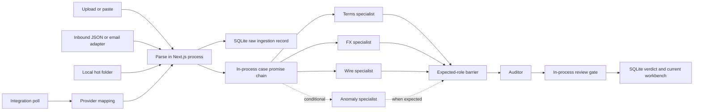

# Current Behavior and Gaps

This page records behavior visible in the current source tree. It distinguishes persisted data from process-local state and provider-specific code from catalog entries.

## Current request and processing flow

Uploads and inbound webhooks parse in the request process. Upload and webhook bodies have endpoint-specific streaming size limits. The API normally returns `202` after parsing and starting an in-process queue operation, not after the audit finishes. Three specialist agents run concurrently per case. The anomaly agent runs when candidate wires or account-change evidence is present. The auditor starts after all expected specialists complete. Cases are serialized through a process-local promise chain. See [`src/runtime/orchestrator.ts`](../../src/runtime/orchestrator.ts).

## Feature status

| Area | Implemented now | Production gap |
| --- | --- | --- |
| Data Sources | Upload, text paste, JSON webhook, email-adapter JSON, local hot folder, and integration catalog. The upload API enforces request and decoded-PDF byte limits, rejects binary base64 outside the PDF path, checks PDF header and EOF markers, limits PDF stream count and decompressed output, and fails scanned or non-text PDFs that need OCR. Configured ClamAV scanning covers upload bodies, email attachments, and hot-folder files. Production fails closed when scanning is unavailable; local development records `not_configured` and continues. Stripe, Wise, QuickBooks Online, and Xero have provider-specific polling with bounded page traversal and raw response retention. Stripe payout sync uses a created-time cursor, QuickBooks invoice sync filters `MetaData.LastUpdatedTime`, and Xero invoice sync uses `If-Modified-Since`; all use a five-minute overlap. Changed provider source content creates an immutable revision case rather than replacing the earlier audit. Expired Wise, QuickBooks, Xero, and TrueLayer OAuth tokens refresh before sync, with new credentials encrypted and saved. Refresh attempts use expiring SQLite leases, coordinating local processes that share the same database file. The catalog labels native APIs, generic single-request JSON endpoints, local folder intake, and email webhook delivery separately. Generic endpoints require an explicit URL, validate HTTPS and DNS addresses, reject private/reserved destinations, require an exact hostname allowlist in production, and refuse redirects before forwarding the configured bearer token. | No ClamAV service is configured locally. A production ClamAV endpoint must be private because the daemon TCP protocol does not authenticate or encrypt traffic. Wise transfer listing still uses offset pagination without an incremental time cursor. Xero notes that some changes do not appear through `If-Modified-Since`, so the cursor is not a complete change feed. Provider revocation, full payment matching, and provider conformance remain open. Refresh coordination is limited to processes sharing the local SQLite file; a future managed database needs an equivalent cross-instance lock. Generic endpoint DNS validation happens before the request and does not pin the resolved address to the outbound socket, so production egress firewall rules are still required to mitigate DNS rebinding. |
| Raw and normalized financial records | Raw payloads, filenames, ingestion metadata and parse errors, case JSON, verdict JSON, pending approval payloads, and integration credentials are encrypted in SQLite through the AES-256-GCM vault. Legacy sensitive values are encrypted in place on database open. Local development can use a persistent key file; production refuses to create a local key and requires `CORRIDOR_VAULT_KEY`. Decryption errors fail closed and do not silently rotate workspace webhook secrets. Raw-record reads and updates include workspace scope, and case/verdict writes reject case-ID ownership conflicts across workspaces. Existing routes decrypt records for inspect, download, reprocess, and case loading. Upload and webhook request sizes are bounded. Provider sync retains fetched response pages. | API routing and login still select the fixed `ws-default`; workspace selection from verified identity is not implemented. Production key handling is not yet integrated with AWS KMS or a managed secret provider. Case IDs, titles, sync errors, event identifiers, and other operational columns remain plaintext. A digest stored beside an editable database row is not tamper evidence. Generic endpoints and local folder adapters may still preserve normalized cases rather than provider originals. Key rotation, malware scanning, retention, and immutable evidence custody are missing. |
| Corridor summary | UI totals saved verdict fields and lists cases. Evidence-incomplete invoice-only cases are excluded from fee and FX totals. Fee and FX labels describe calculated flags and estimates. | Summary is not grouped into a complete corridor analytics model. Amount flags are not independently verified recoveries. Zero variance is arithmetic over submitted values, not proof that source records are authentic. |
| Review gate | Risk-only and every-tool modes. Risk Only pauses for recoverable OUR fee flags, above-threshold variance, duplicate classification, or supplied bank-change signal. Nonzero below-threshold differences remain visible in the verdict. Variance thresholds are versioned and recorded in verdict source references. Threshold units are minor units in each case settlement currency. Pending review records and approve, reject, and stop decisions persist in SQLite against the exact tool call. Pending approvals are restored to the workbench after reload or restart, and decisions address the displayed approval ID. Repeated pauses of the same tool call reuse the same pending record. A pending human decision pauses the case verdict timeout; a resolved decision replays an already dead-lettered case from the persisted record. Authenticated decisions retain reviewer subject, email, and role. Authenticated manual uploads record the submitter subject, who cannot approve that case; a different authenticated controller or owner must approve it. Local single-operator mode remains usable, and webhook or provider initiated cases remain system initiated. | The agent execution remains process-local and restarts by replaying the case. There is no approval history UI, expiry or cancellation policy, or separate worker deployment. A human review can keep the sequential local case queue waiting until an operator decides. |
| Workspace and tax profile | A single `ws-default` workspace can store name, mode, currency, country, withholding rate, variance threshold, and webhook signature setting. Tax and review settings are versioned. An explicit invoice rate, including zero, takes precedence; an omitted rate uses the current workspace profile and records the applied version and source in the terms assessment. | API routes select the fixed workspace. The tax profile is a configured basis-point assumption, not a statutory tax engine or jurisdictional determination. Historical replay under old policy and approved effective-date changes are not implemented. |
| Identity and API access | Cognito authorization-code login uses PKCE, state, nonce, verified email, and signed HTTP-only sessions. New sessions receive a unique ID and are persisted in SQLite. Logout revokes the session; Node API handlers check the active session and current team membership and role against the stable Cognito subject. Mutating protected API calls reject a different `Origin` and browser `Sec-Fetch-Site: cross-site` requests in both authenticated and local modes. The live SSE stream rechecks session revocation, membership, and token expiry every 15 seconds. A verified invited email binds to a subject once, and a later Cognito subject cannot claim that member record. Existing SQLite databases create the session table without replacing team rows. Provider OAuth states are one-use, expiring SQLite records, and Xero and TrueLayer use S256 PKCE with encrypted verifiers. Integration redirect URIs use the configured `CORRIDOR_PUBLIC_BASE_URL`; development without it only accepts loopback HTTP origins. | Cognito has not been configured. Sessions expire after one hour. Middleware page checks verify the signed token but do not read the SQLite revocation store; protected data APIs do check it. Team invitations do not send email, workspace identity remains fixed to `ws-default`, Stripe, Wise, and QuickBooks OAuth flows do not yet use PKCE, and session/OAuth state is not stored in a managed multi-host database or KMS. Set the public base URL to the exact registered HTTPS origin before production. |
| Team | Owner, controller, analyst, and viewer roles are applied to protected routes. Verified invited members activate on first sign-in. A configured bootstrap email can create the initial owner. | No invitation email is sent. The owner must provision the invited address in Cognito or otherwise arrange identity enrollment. |
| Health and runtime status | Public `/api/health` returns a minimal liveness signal. The UI reads provider, queue, build, and runtime details from authenticated `/api/runtime/status`. | Health is liveness only, not a dependency readiness check. The detailed endpoint reflects one process and local queue state, not a fleet-wide health view. |

| Webhooks | Stripe uses its signed timestamp and HMAC-SHA256. Wise uses RSA-SHA256 over the exact raw body and Wise's environment-specific public key. Corridor production signatures use a signed timestamp and HMAC-SHA256. All are compared against the raw request body before parsing. SQLite stores encrypted raw payloads and event receipts transactionally; duplicate event IDs return the original ingestion and changed content under the same ID is rejected. For supported events, the route now saves the durable case rows before marking the receipt queued or returning `202`. A failed queue write returns an error, and a provider retry can resume a receipt left in `received` or `failed`. Unsupported signed payloads are retained as failed evidence, not labeled queued. | Wise webhook signatures have no signed timestamp header. Delivery deduplication uses an event ID from the body or an exact-body digest; this is not a cryptographic single-use guarantee. Receipt and case rows are not committed in one transaction, so a crash between those writes relies on provider retry. The local case queue is not a distributed queue. A valid signature authenticates the signed body, not its accounting meaning. Wise key selection uses the built-in sandbox key in non-production and production key in production, with `WISE_WEBHOOK_PUBLIC_KEY` and `WISE_WEBHOOK_ENVIRONMENT` overrides for key rotation or explicit environment selection. |
| Case processing queue | Case payloads, statuses, attempt counts, retry time, errors, worker ownership, expiring leases, and verdicts persist in SQLite. Atomic conditional claims prevent two processes sharing the local database from starting the same live case lease. Workers renew leases every 20 seconds; expired claims become eligible for recovery, and completion is accepted only for the current lease owner. Local processing retries eligible failures up to three attempts with backoff, then moves exhausted cases to dead letter. Agent verdict timeouts go directly to dead letter. Controller-only APIs list and replay dead letters. If no LLM provider is configured, accepted cases remain queued and resume after configuration; the CLI reports the missing setup. | This is local shared-file coordination only. SQLite remains single-host storage and the orchestrator, agent runtime, scheduler, and SSE state are still process-local. There is no independently deployed worker, distributed queue, transactional event outbox, or multi-host coordination. |
| Integrations and scheduling | Sync records are persisted. A manual sync awaits provider fetch. Each run stores its queued case IDs and reports provider fetch status separately from audit status derived from the durable case queue: queued, running, completed, failed, partial, or unknown. A successful fetch therefore does not imply completed audits. Older sync rows without case IDs show audit status as unknown. SQLite sync leases serialize manual and scheduled fetches across processes sharing the local database, refresh while a fetch is active, and allow stale running sync records to be marked interrupted after lease recovery. The timer retries connected integrations and stale `syncing` integrations. Provider API and OAuth token HTTP requests use a 20 second timeout. | The timer is not a durable scheduler and can run in multiple application instances. A conflicting manual sync waits up to 30 seconds before returning HTTP 409. Sync leases coordinate only processes sharing the same local SQLite file. There is no durable retry schedule or dead-letter workflow for provider sync jobs. The timeout applies per HTTP request, so a full paginated sync can still take longer. |
| Local persistence | `node:sqlite` uses `DatabaseSync` and writes to `data/corridoraudit.db` by default. Cases, verdicts, raw records, integrations, and sync history persist locally. `npm run db:backup` creates a SQLite `VACUUM INTO` copy, checks `PRAGMA integrity_check`, and refuses to overwrite an existing backup. An automated restore test opens the copy and reads encrypted records. | Backups are operator-triggered and local only. There is no schedule, retention cleanup, off-site copy, alerting, managed backup/restore process, database failover, or migration service. Synchronous SQLite is not the production multi-instance database, and route-level tenant selection is not implemented. |

## Workspace audit trail

Selected workspace settings, team membership, webhook-secret rotation, integration connect/disconnect, accepted inbound webhook and email intake, parse completion/failure, webhook receipt status, approval requests and decisions, final case verdicts, integration sync start/completion, and case queue claims, retries, dead letters, recovery, and replay append to `workspace_audit_log`. Intake receipts and parse outcomes are committed with their audit events. Queue transitions, review operations, verdicts, sync lifecycle, and workspace/integration setting mutations share a SQLite transaction with their corresponding durable state change. Records are sequenced per workspace, linked with SHA-256 hashes, and exposed through the authenticated owner/controller-only `GET /api/audit-log?limit=100` endpoint. The response includes a bounded event page and a verification result for the full local chain. Metadata is capped at 4 KB and current callers record action attributes only, never credentials or raw financial payloads.

The hash chain detects row edits and interior deletion, but not an unanchored deletion of the latest events or a privileged rewrite of the SQLite file and hashes. There is no external hash anchor, retention lock, export sink, or alerting. Invalid webhook signatures are rejected before durable receipt storage and are not included in this event log. The log is an operational history feature, not a certified compliance ledger.

## Important source limitations

Supported JSON case arrays and case objects now pass Zod validation for core amount, currency, date, invoice, wire, and fee fields. A JSON case is only marked observed when invoice and wire evidence have distinct source references and both charge lists are present. The email webhook validates its supported envelope, field types, attachment count, and string bounds while allowing provider-specific extra fields; malformed signed JSON is retained as failed raw evidence. Provider webhook payloads still need provider-specific schemas. Invoice-only CSV, text, PDF, and supported JSON normalization marks generated comparison wires as estimated. Wire-only records and payments whose invoice expectation is derived from the same MT103/camt.053 or payout row are incomplete. QuickBooks and Xero invoice mappings are estimated, and their required structural wire now has a zero amount with an explicit gap explaining that no payment was fetched. These records finalize as `EVIDENCE_INCOMPLETE` and cannot create fee-dispute drafts. Complete evidence validation across all ingestion paths remains open work.

Stripe, Wise, QuickBooks, and Xero poll through provider pages, with a 100-page safety limit and captured raw page responses. QuickBooks and Xero currently poll invoices only. Their structural wires have zero settled value and are not payment evidence. Stripe payout sync persists a created-time cursor, QuickBooks invoice sync filters on `MetaData.LastUpdatedTime`, and Xero invoice sync uses an `If-Modified-Since` cursor; each query overlaps the last successful sync time by five minutes. QuickBooks supports `MetaData.LastUpdatedTime` filtering and ordering in its query API, but the adapter still needs conformance tests against a real connected company. Wise transfer listing still has no incremental time cursor. Xero documents that some changes may not appear through its modification filter, so periodic full reconciliation remains necessary. These connectors do not yet match invoices to independent payment and bank settlement records. The connector implementation is in [`src/core/integrations/connectors.ts`](../../src/core/integrations/connectors.ts).

## Current source locations

- Intake and parsing: [`src/app/api/audit/upload/route.ts`](../../src/app/api/audit/upload/route.ts), [`src/core/ingest/normalize-upload.ts`](../../src/core/ingest/normalize-upload.ts)
- Storage: [`src/core/db/schema.ts`](../../src/core/db/schema.ts), [`src/core/db/database.ts`](../../src/core/db/database.ts)
- Queue and sync timer: [`src/runtime/orchestrator.ts`](../../src/runtime/orchestrator.ts), [`src/runtime/workers/sync-worker.ts`](../../src/runtime/workers/sync-worker.ts)
- Review gate and calculations: [`src/runtime/interception/settlement-gate.ts`](../../src/runtime/interception/settlement-gate.ts), [`src/runtime/tools/audit-tools.ts`](../../src/runtime/tools/audit-tools.ts)
- Workspace and team settings: [`src/app/api/settings/workspace/route.ts`](../../src/app/api/settings/workspace/route.ts)
- Webhook verification: [`src/core/security/webhook-signatures.ts`](../../src/core/security/webhook-signatures.ts)
