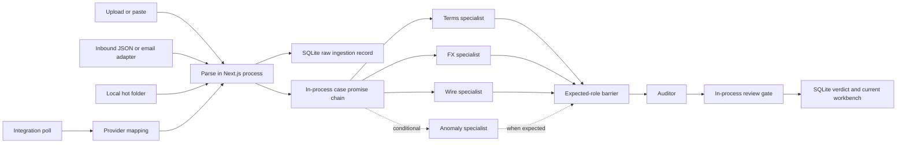

# Current Behavior and Gaps

This page records behavior visible in the current source tree. It distinguishes persisted data from process-local state and provider-specific code from catalog entries.

## Current request and processing flow

Uploads and inbound webhooks parse in the request process. The API normally returns `202` after parsing and starting an in-process queue operation, not after the audit finishes. Three specialist agents run concurrently per case. The anomaly agent runs when candidate wires or account-change evidence is present. The auditor starts after all expected specialists complete. Cases are serialized through a process-local promise chain. See [`src/runtime/orchestrator.ts`](../../src/runtime/orchestrator.ts).

## Feature status

| Area | Implemented now | Production gap |
| --- | --- | --- |
| Data Sources | Upload, text paste, JSON webhook, email-adapter JSON, local hot folder, and integration catalog. Stripe, Wise, QuickBooks Online, and Xero have provider-specific polling code. | Polling is limited and does not yet provide complete, reconciled source records. Other catalog options may use a generic JSON endpoint, local folder, or setup-only record. OAuth token refresh, pagination, cursors, and provider conformance are incomplete. |
| Raw records | SQLite stores payload text or base64, SHA-256, metadata, parse status, and linked case IDs. Reprocess and download routes exist. | Raw payloads and case JSON are not encrypted at the application layer. A digest in the same writable database is not tamper evidence. Platform sync currently saves normalized cases rather than the original response. Upload limits, malware scanning, retention, and access authorization are missing. |
| Corridor summary | UI totals saved verdict fields and lists cases. Evidence-incomplete invoice-only cases are excluded from fee and FX totals. Fee and FX labels describe calculated flags and estimates. | Summary is not grouped into a complete corridor analytics model. Amount flags are not independently verified recoveries. Zero variance is arithmetic over submitted values, not proof that source records are authentic. |
| Review gate | Risk-only and every-tool modes. Risk Only pauses for recoverable OUR fee flags, above-threshold variance, duplicate classification, or supplied bank-change signal. Nonzero below-threshold differences remain visible in the verdict. | Gate mode, pending approvals, queue, and run state are process-local. Approval identity and role are not recorded. |
| Workspace and tax profile | A single `ws-default` workspace can store name, mode, currency, country, a withholding rate, a variance threshold, and webhook signature setting. | API routes select the fixed workspace. The tax country and workspace withholding rate do not feed audit calculations. Invoice supplied withholding is used, otherwise calculation defaults to zero. |
| Team | Member rows can be created with an invited status and deleted. | No invitation is delivered. Roles are not enforced. No in-app authentication or workspace access control protects the current API routes. |
| Webhooks | HMAC checks exist for Stripe, Wise, and Corridor signatures. Stripe timestamp tolerance is 300 seconds. The workspace flag can require a recognized signature. | The flag defaults to false. Wise and Corridor signatures do not have a timestamp window. There is no durable provider event ID ledger or deduplication. A valid signature only authenticates a signed body, not its accounting meaning. |
| Integrations and scheduling | Sync records are persisted. A manual sync awaits provider fetch. An in-process timer polls connected integrations at a configurable interval. | The timer is not a durable scheduler and can run in multiple application instances. Sync success records fetch completion, not audit completion. Background jobs have no durable lease, retry policy, or dead-letter process. |
| Local persistence | `node:sqlite` uses `DatabaseSync` and writes to `data/corridoraudit.db` by default. Cases, verdicts, raw records, integrations, and sync history persist locally. | Synchronous SQLite is not the production multi-instance database. There is no managed backup/restore process, database failover, migration service, or tenant-aware data authorization. |

## Important source limitations

The ingestion normalizer still accepts JSON using TypeScript casts and format heuristics. Invoice-only CSV, text, PDF, and supported JSON normalization now marks generated comparison wires as estimated. QuickBooks and Xero invoice mappings are also marked estimated. Those records finalize as `EVIDENCE_INCOMPLETE` and cannot create fee-dispute drafts. Strict input validation, upload limits, and complete evidence validation across all ingestion paths remain open work.

Stripe polling currently requests a limited payout page. Wise polling requests a limited transfer page. QuickBooks and Xero poll invoices and create placeholder wires. The connector implementation is in [`src/core/integrations/connectors.ts`](../../src/core/integrations/connectors.ts).

## Current source locations

- Intake and parsing: [`src/app/api/audit/upload/route.ts`](../../src/app/api/audit/upload/route.ts), [`src/core/ingest/normalize-upload.ts`](../../src/core/ingest/normalize-upload.ts)
- Storage: [`src/core/db/schema.ts`](../../src/core/db/schema.ts), [`src/core/db/database.ts`](../../src/core/db/database.ts)
- Queue and sync timer: [`src/runtime/orchestrator.ts`](../../src/runtime/orchestrator.ts), [`src/runtime/workers/sync-worker.ts`](../../src/runtime/workers/sync-worker.ts)
- Review gate and calculations: [`src/runtime/interception/settlement-gate.ts`](../../src/runtime/interception/settlement-gate.ts), [`src/runtime/tools/audit-tools.ts`](../../src/runtime/tools/audit-tools.ts)
- Workspace and team settings: [`src/app/api/settings/workspace/route.ts`](../../src/app/api/settings/workspace/route.ts)
- Webhook verification: [`src/core/security/webhook-signatures.ts`](../../src/core/security/webhook-signatures.ts)
