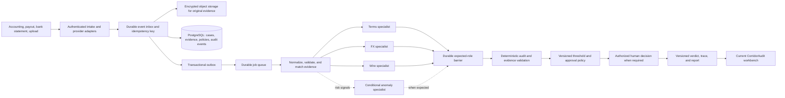

# Target Production Architecture

The target keeps the finance-specific case workflow. It does not add a general workflow editor. Provider adapters submit evidence into one durable case pipeline, and the existing workbench remains the operator experience.

## End-to-end target flow

## Data sources and minimum evidence

Preserve the current catalog and intake screens, but expose capability and readiness per adapter. Each catalog entry must say whether it supports authentication, pagination, incremental sync, raw response capture, provider event verification, and validated field mapping.

The core settlement case should link three independently sourced record types:

1. **Expected obligation:** invoice or contract, amount, currency, fee bearer, due date, and any source-backed tax withholding.
2. **Payout instruction and provider result:** payout or transfer ID, source and target amounts, provider-applied rate, fees, status, and references.
3. **Receiving account evidence:** bank transaction or statement entry confirming the amount that landed and its value date.

An invoice without payout evidence remains `awaiting_payout_evidence`. A payout without bank evidence remains `awaiting_bank_evidence` if the workflow requires confirmation. Neither is finalized as a clean settlement. Provider APIs must not create synthetic wire records to make an invoice appear paid.

Every adapter maps its vendor response into a versioned canonical schema while retaining the exact original response or uploaded file. Field-level evidence links include source object ID, source field path, source timestamp, capture time, parser version, mapping version, and digest. Parser output is untrusted until validated.

## Identity, workspaces, and roles

- Use an established OpenID Connect identity provider. The production recommendation for eventual AWS hosting is Amazon Cognito. Keep issuer, audience, client, redirect URI, and key-cache settings in environment configuration. Run the current local app without external credentials only in an explicitly marked development mode.
- Use Authorization Code with PKCE, secure HTTP-only cookies, CSRF protection on state-changing browser requests, session expiry and revocation, and server-side role checks. OAuth state must be transaction-bound and work across application instances. Follow [IETF RFC 9700](https://www.rfc-editor.org/rfc/rfc9700.html).
- Derive workspace identity from the verified session, never from a user-submitted workspace ID. Apply tenant scope in every database query, raw object lookup, queue job, SSE subscription, report, integration, and approval action.
- Enforce `owner`, `controller`, `analyst`, and `viewer` permissions server-side. Persist the acting user, workspace, role, decision, time, and case evidence version for approvals and policy changes.
- Team invitations require single-use expiring tokens and a configured mail delivery service. A database row marked invited is not an invitation until a verified user accepts it.

## Persistence, queue, and state

For production deployment, use a managed PostgreSQL database for relational records and policy state, encrypted S3 storage for source files, and a durable queue. The recommended AWS deployment is ECS/Fargate workers, RDS PostgreSQL, SQS, S3, KMS, and Cognito. Keep the Next.js workbench stateless so it can scale independently. Local development may continue to use SQLite until a local PostgreSQL profile is deliberately added.

Persist an event and its queue message using a transactional outbox. Webhook intake returns success only after the raw event and outbox item commit. Queue consumers use idempotency keys, leases, bounded retries with backoff, dead-letter review, and replay. Case stages and agent results are persisted so process restarts do not discard work or approvals. A job marked successful means the defined job stage completed; fetch completion and audit completion are separate states.

The queue is at-least-once. Each operation must therefore be safe to retry. Do not promise exactly-once delivery. Deduplicate webhook deliveries by provider event ID and case work by stable source record IDs plus mapping version.

## Raw evidence and security

- Store original payloads in private object storage with encryption, versioning, access logging, lifecycle retention, and a documented deletion process. Store references and digests in PostgreSQL.
- Use KMS-managed envelope encryption for database and object-storage keys. Keep provider tokens in a secret store or encrypted credential store with rotation and revocation. Do not generate a fresh local vault key silently in production.
- Enforce per-route body, file, and decompressed-size limits. Validate extension and file signature, allowlist supported formats, scan uploaded files, and keep parsing isolated with CPU, memory, and time limits. OWASP's [File Upload Cheat Sheet](https://cheatsheetseries.owasp.org/cheatsheets/File_Upload_Cheat_Sheet.html) describes these controls.
- Keep raw evidence immutable through storage versioning and append-only audit events. A SHA-256 digest is a useful integrity check only when the digest itself and its custody are protected.
- Apply explicit retention, access logging, masking, and deletion rules to personal and financial information. Determine regulatory and contractual obligations for the actual product role and markets before launch.

## Webhook and integration behavior

- Require the provider's signature for every configured provider endpoint. Use the provider's official verification implementation, secret rotation, bounded timestamp tolerance where supported, constant-time comparisons, event-ID deduplication, and safe handling of unknown event types.
- Persist the event before acknowledging it, enqueue it durably, and make retries and redelivery safe. Expose delivery attempts and dead-letter/replay status to authorized operators. See [OWASP Webhook Security guidance](https://cheatsheetseries.owasp.org/cheatsheets/Webhook_Security_Cheat_Sheet.html).
- Implement provider adapters separately. Each adapter owns OAuth scopes, pagination, backfill, sync cursors, throttling, token refresh, revocation, source-response capture, schema validation, and reconciliation tests. Generic endpoint polling is a configurable adapter, not a certified connector.
- Use provider-specific webhook secrets and integration credentials scoped to one workspace and account. Do not use a single shared secret to authenticate unrelated vendors.

## Versioned policies and review

Persist policy versions with the case when the case is created. A policy contains currency-specific variance thresholds, FX comparison method, fee interpretation, evidence completeness requirements, risk categories, and approval requirements. Thresholds use explicit currency and minor units. They are not converted silently using an unrelated default currency.

Tax is not a universal workspace rate. Support source-provided withholding fields and an explicitly approved workspace fallback only when the organization has configured its legal basis, country, effective dates, source, and reviewer. Report which value was used. Do not derive legal tax treatment from an LLM.

Risk policy is deterministic and versioned. Model outputs may extract or summarize information but cannot alter canonical amounts, suppress source gaps, lower a gate, or approve an action. Human approval is bound to an authenticated reviewer, the exact case and evidence version, policy version, decision, and reason. Reports are marked superseded if their evidence or policy version changes.

## Operational visibility

Use correlation IDs across intake, provider events, queue jobs, cases, agent runs, approvals, and reports. Publish metrics for queue age, retry counts, provider sync lag, parse failures, unmatched evidence, audit latency, gate wait time, and dead-letter volume. Alert on stale jobs, repeated auth failures, key decryption errors, missed sync schedules, and backup failures. Store logs without raw payloads or credentials.
